# Bioacoustic dataset landscape — aggregated survey analysis

Six independent dataset surveys in this folder were normalised onto one schema and
deduplicated. **400 survey rows collapsed to 288 distinct resources** (282 datasets plus 6
review/survey papers that one source survey had mixed in).

| File | Rows contributed |
|---|---|
| `bioacoustics_datasets.csv` | 127 |
| `bioacoustic_sound_event_and_mammal_datasets (1).csv` | 104 |
| `bioacoustic_datasets_catalog.csv` | 130 |
| `bioacoustic_sound_event_detection_and_mammal_datasets.csv` | 27 |
| `gemini-code-1789914748663.csv` | 12 |
| `bioacoustic_sound_event_and_mammal_datasets.csv` | superseded — see note below |

The older `bioacoustic_sound_event_and_mammal_datasets.csv` is a strict earlier revision of
the `(1)` file: identical dataset IDs and names for its first 73 rows, fewer columns. Only
its `relationship_notes` column carried information the newer file had dropped, so that text
was merged into the newer rows and the file was otherwise dropped rather than
double-counted.

**Outputs**

- `bioacoustic_datasets_unified.csv` — canonical, 60 columns, one row per resource.
- `bioacoustic_datasets_unified_compact.csv` — the same 288 rows projected onto the exact
  14-column layout of `bioacoustics_datasets.csv`.
- `figures/` — the charts below, as light/dark pairs.

Every row carries a `source_surveys` field naming the file(s) and row/ID it came from, so
any number here can be traced back. 70 rows are merges of two or more survey rows; their
`notes` field starts with `MERGED from N survey rows` and states the rationale.

## 1. How much the surveys actually overlapped

<picture>
  <source media="(prefers-color-scheme: dark)" srcset="figures/survey-overlap-dark.png">
  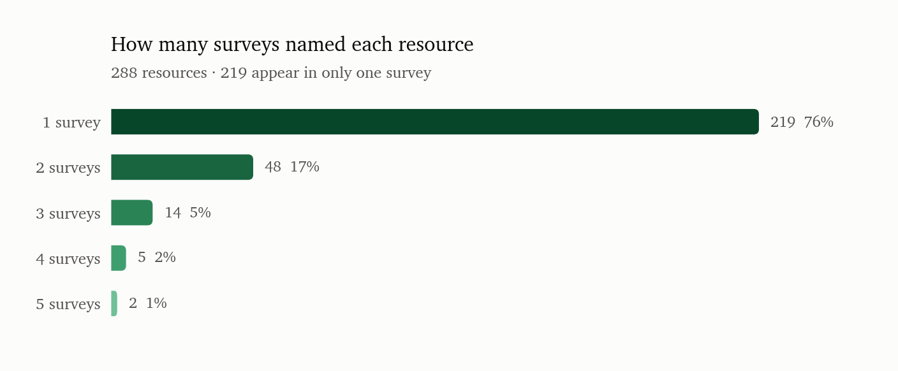
</picture>

| Surveys naming this resource | resources | share |
|------------------------------|-----------|-------|
| 1                            | 219       | 76%   |
| 2                            | 48        | 17%   |
| 3                            | 14        | 5%    |
| 4                            | 5         | 2%    |
| 5                            | 2         | 1%    |

Only 69 resources (24%) were named by two or more surveys; 219 (76%) appear in exactly one.
The surveys agree far less than their overlapping titles suggest — each contributed a large
tail of datasets no other survey found.

## 2. Taxonomic distribution

<picture>
  <source media="(prefers-color-scheme: dark)" srcset="figures/taxa-dark.png">
  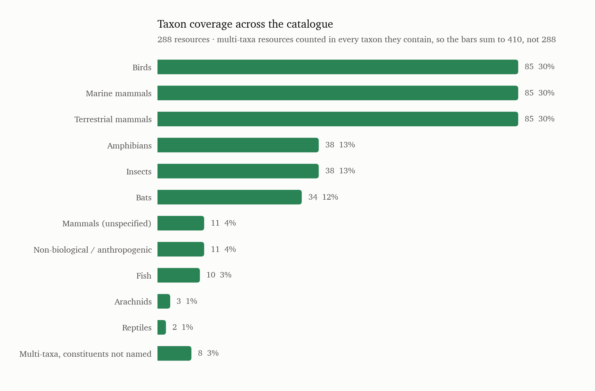
</picture>

| Taxon                              | single-taxon resources | from multi-taxa | total | share of 288 |
|------------------------------------|------------------------|-----------------|-------|--------------|
| Birds                              | 45                     | 40              | 85    | 30%          |
| Marine mammals                     | 74                     | 11              | 85    | 30%          |
| Terrestrial mammals                | 68                     | 17              | 85    | 30%          |
| Amphibians                         | 8                      | 30              | 38    | 13%          |
| Insects                            | 6                      | 32              | 38    | 13%          |
| Bats                               | 23                     | 11              | 34    | 12%          |
| Mammals (unspecified)              | 0                      | 11              | 11    | 4%           |
| Non-biological / anthropogenic     | 2                      | 9               | 11    | 4%           |
| Fish                               | 7                      | 3               | 10    | 3%           |
| Arachnids                          | 1                      | 2               | 3     | 1%           |
| Reptiles                           | 2                      | 0               | 2     | 1%           |
| Multi-taxa, constituents not named | 0                      | 8               | 8     | 3%           |

Multi-taxa resources are counted in **every** taxon they contain, so the totals sum to 410,
not 288; the share column reads as "this fraction of the catalogue covers this taxon". The
table splits each total into resources dedicated to that taxon alone and resources that
reach it through a multi-taxa corpus.

Three groups tie at the top — birds, marine mammals and terrestrial mammals, 85 resources
each (30% of the catalogue) — but they get there very differently. Marine and terrestrial
mammal coverage is overwhelmingly **dedicated**: 74 and 68 of their 85 are single-taxon
releases. Bird coverage is the opposite: only 45 resources are bird-only, and the other 40
arrive inside multi-taxa corpora — aggregators, soundscape collections and cross-taxa
benchmarks.

That split matters more than the totals. Mammal data in this catalogue tends to be a study
release about one species; bird data tends to be a slice of something larger.

Redistribution also changes which taxa look neglected. Amphibians go from 8 dedicated
resources to 38 total, and insects from 6 to 38 — both are reasonably well covered, but
almost entirely as one voice in a soundscape rather than as a dataset of their own. The
genuinely thin groups survive the redistribution: fish (10), arachnids (3) and reptiles (2).

Two bars are bookkeeping rather than taxa. **Mammals (unspecified)** is 11 multi-taxa
resources that say "mammals" without saying which kind, so they could not be assigned to the
marine, terrestrial or bat bars. **Multi-taxa, constituents not named** is 8 resources that
claim breadth and name nothing at all; they are kept visible rather than dropped.

### The same distribution, restricted to what you can download

Everything above counts a resource whether or not anyone outside the originating group can
obtain it. This applies the catalogue's own `publicly_available` field and keeps only the
resources recorded as **yes** — strictly, since "partial" gates some subsets and "unknown"
means no survey checked, and neither is something you can rely on. Multi-taxa resources are
still counted in every taxon they contain, and the row order is the full catalogue's, so the
two figures read against each other.

<picture>
  <source media="(prefers-color-scheme: dark)" srcset="figures/taxa-public-dark.png">
  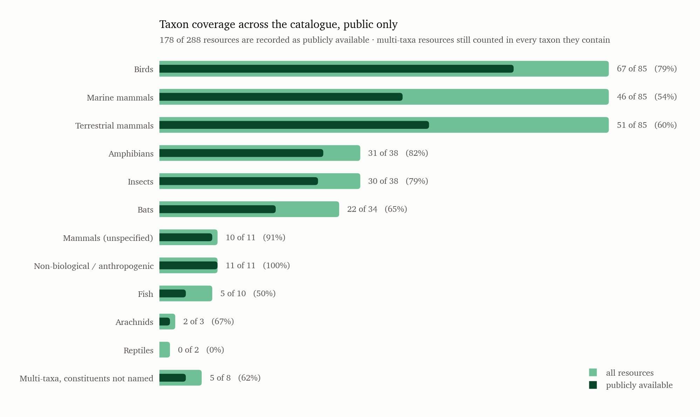
</picture>

| Taxon | All | Public | % public | Share of all | Share of public |
|---|---|---|---|---|---|
| Birds | 85 | 67 | 79% | 20.7% | 23.9% |
| Marine mammals | 85 | 46 | **54%** | 20.7% | 16.4% |
| Terrestrial mammals | 85 | 51 | 60% | 20.7% | 18.2% |
| Amphibians | 38 | 31 | 82% | 9.3% | 11.1% |
| Insects | 38 | 30 | 79% | 9.3% | 10.7% |
| Bats | 34 | 22 | 65% | 8.3% | 7.9% |
| Mammals (unspecified) | 11 | 10 | 91% | 2.7% | 3.6% |
| Non-biological / anthropogenic | 11 | 11 | **100%** | 2.7% | 3.9% |
| Fish | 10 | 5 | 50% | 2.4% | 1.8% |
| Multi-taxa, constituents not named | 8 | 5 | 62% | 2.0% | 1.8% |
| Arachnids | 3 | 2 | 67% | 0.7% | 0.7% |
| Reptiles | 2 | 0 | **0%** | 0.5% | 0.0% |

**178 of 288 resources are recorded as public** — 62%, against 53% for the mammal subset
alone. The rest are 60 unknown, 28 not released and 22 partial.

**The three-way tie at the top breaks.** Birds, marine mammals and terrestrial mammals are
each 85 resources in the full catalogue and exactly level. Filtering separates them: birds
79% public, terrestrial mammals 60%, **marine mammals 54%**. Birds gain two points of share
and marine mammals lose four. The reason is the split described above — bird coverage arrives
largely inside multi-taxa benchmarks and soundscape collections, which are published to be
used, whereas marine mammal coverage is dedicated study releases and long-term monitoring
archives, which are the things most often held behind a collaboration agreement.

**Openness runs opposite to how well-studied a taxon is.** The three most open categories are
non-biological sound (11 of 11), mammals-unspecified (10 of 11) and amphibians (31 of 38);
the least open are reptiles (0 of 2), fish (5 of 10) and marine mammals. Amphibians and
insects, which the redistribution showed are covered almost entirely as one voice inside
soundscape corpora, are also among the most downloadable, for the same reason.

**Reptiles go to zero.** Both resources are unchecked rather than refused, but the effect is
the same: the catalogue supports no verifiable statement about reptile bioacoustics. Fish
halve to 5. Arachnids hold at 2 of 3, which is enough to keep the jumping spider measurement
in the frequency section on public data.

The mammal version of this figure is `clade-public` in the mammal report, which adds what the
filter costs by volume as well as by dataset count.

### What is inside "Multi-taxa"

"Multi-taxa" is the third-largest group but it is a container, not a taxon. Resolving what
those 52 resources actually contain — from their own taxon and species fields — gives:

<picture>
  <source media="(prefers-color-scheme: dark)" srcset="figures/multi-taxa-breakdown-dark.png">
  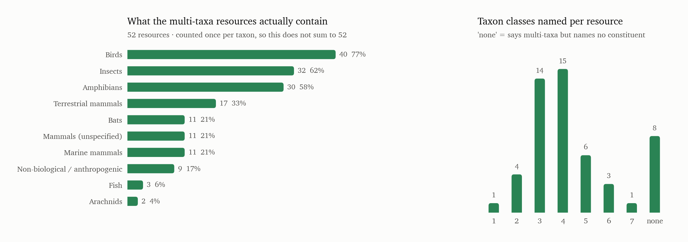
</picture>

| Contains                       | resources | share of the 52 |
|--------------------------------|-----------|-----------------|
| Birds                          | 40        | 77%             |
| Insects                        | 32        | 62%             |
| Amphibians                     | 30        | 58%             |
| Terrestrial mammals            | 17        | 33%             |
| Bats                           | 11        | 21%             |
| Mammals (unspecified)          | 11        | 21%             |
| Marine mammals                 | 11        | 21%             |
| Non-biological / anthropogenic | 9         | 17%             |
| Fish                           | 3         | 6%              |
| Arachnids                      | 2         | 4%              |

A resource is counted once per taxon it contains, so the column sums past 52.

The group is dominated by **terrestrial soundscape corpora**: birds, insects and amphibians
together — the dawn/dusk chorus combination — appear in 27 of the 52, and 32 include at
least one invertebrate class. This is where almost all of the catalogue's invertebrate
coverage lives: outside this group there are only 6 insect-only and 1 arachnid-only
resources.

35 of the 52 include some mammal class, but usually as one line in a broad aggregator
(AudioSet, GBIF, iNaturalist, Macaulay) rather than as annotated mammal audio. Marine
mammals appear in only 11 — marine work in this catalogue is overwhelmingly single-taxon,
which is why marine mammals top the main chart above while barely registering here.

The most common exact combinations:

| Combination                                          | resources |
|------------------------------------------------------|-----------|
| Amphibians + Birds + Insects + Mammals (unspecified) | 7         |
| Amphibians + Birds + Insects                         | 7         |
| Amphibians + Bats + Birds + Insects                  | 3         |
| Bats + Birds + Insects                               | 2         |
| Birds + Marine mammals + Terrestrial mammals         | 2         |
| Bats + Birds + Marine mammals + Terrestrial mammals  | 2         |

8 resources say "multi-taxa" or "cross-taxa" without naming a single constituent, 4 of them
the review papers. The rest are vague survey entries —
`POW (Pool of Widely used soundscapes)`, `SoundscapeDB`, a tropical nocturnal soundscape
row, and the AudioSet-derived PANNs/VGGSound training pool — and they are among the
placeholder rows flagged in section 9.

### Recording environment

| Environment            | datasets | share |
|------------------------|----------|-------|
| terrestrial            | 185      | 64%   |
| marine                 | 85       | 30%   |
| both                   | 10       | 3%    |
| terrestrial/freshwater | 4        | 1%    |
| unknown                | 4        | 1%    |

## 3. Where the data lives

<picture>
  <source media="(prefers-color-scheme: dark)" srcset="figures/hosts-licence-dark.png">
  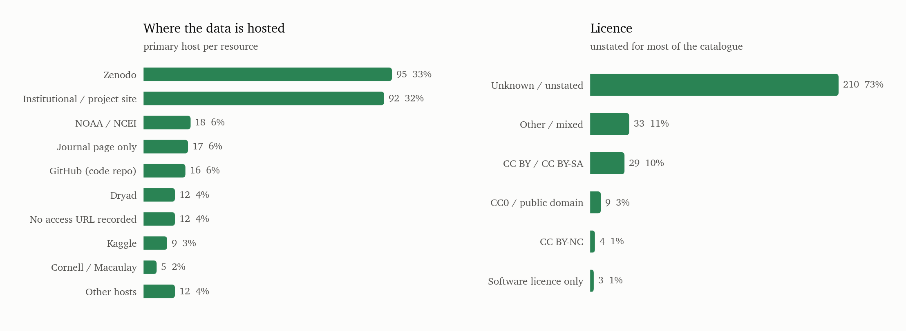
</picture>

| Primary host                 | datasets | share |
|------------------------------|----------|-------|
| Zenodo                       | 95       | 33%   |
| Institutional / project site | 92       | 32%   |
| NOAA / NCEI                  | 18       | 6%    |
| Journal / preprint page only | 17       | 6%    |
| GitHub (code repo)           | 16       | 6%    |
| Dryad                        | 12       | 4%    |
| No access URL recorded       | 12       | 4%    |
| Kaggle                       | 9        | 3%    |
| Cornell / Macaulay           | 5        | 2%    |
| Hugging Face                 | 4        | 1%    |
| GBIF                         | 2        | 1%    |
| WHOI                         | 2        | 1%    |
| xeno-canto                   | 1        | 0%    |
| Borealis                     | 1        | 0%    |
| MBARI                        | 1        | 0%    |
| iNaturalist                  | 1        | 0%    |

Zenodo is the single largest host. The "Institutional / project site" and "No access URL
recorded" rows together are the practical problem: those are resources whose only recorded
route is a lab page, a portal, or nothing at all.

### Licensing

| Licence                                | datasets | share |
|----------------------------------------|----------|-------|
| Unknown / unstated                     | 210      | 73%   |
| Other / mixed                          | 33       | 11%   |
| CC BY / CC BY-SA                       | 29       | 10%   |
| CC0 / public domain                    | 9        | 3%    |
| CC BY-NC (non-commercial)              | 4        | 1%    |
| Software licence only (MIT/Apache/GPL) | 3        | 1%    |

Licence is unstated for the large majority. Where a licence *is* recorded it is usually
Creative Commons, but for any downstream training use the unstated group has to be treated
as unlicensed rather than permissive.

## 4. What the labels look like

### Annotation task

<picture>
  <source media="(prefers-color-scheme: dark)" srcset="figures/annotation-task-dark.png">
  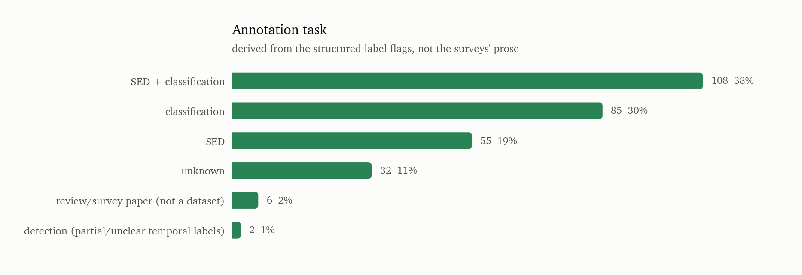
</picture>

| Task                                        | datasets | share |
|---------------------------------------------|----------|-------|
| sound event detection + classification      | 108      | 38%   |
| classification                              | 85       | 30%   |
| sound event detection                       | 55       | 19%   |
| unknown                                     | 32       | 11%   |
| review/survey paper (not a dataset)         | 6        | 2%    |
| detection (partial/unclear temporal labels) | 2        | 1%    |

This is derived from the structured annotation flags (temporal / start-end / bounding-box /
classification), not from the surveys' prose, so it disagrees with some source rows — e.g. a
survey calling freefield1010 a "SED" dataset when its labels are clip-level binary.

### Label strength

| Label strength | datasets | share |
|----------------|----------|-------|
| strong         | 144      | 50%   |
| weak           | 77       | 27%   |
| unknown        | 47       | 16%   |
| mixed          | 20       | 7%    |

### Temporal and spectral precision

| Label property            | yes | partial | no  | unknown |
|---------------------------|-----|---------|-----|---------|
| Any temporal annotation   | 156 | 19      | 83  | 30      |
| Explicit start/end times  | 156 | 18      | 83  | 31      |
| Frequency bounds          | 65  | 10      | 159 | 54      |
| Full time-frequency boxes | 48  | 2       | 145 | 93      |
| Class/species labels      | 193 | 1       | 2   | 92      |

Full time-frequency bounding boxes — the thing you need for spectrogram-level detection —
exist in only 48 of 288 resources (17%), and are absent or unrecorded in the rest.
Onset/offset labels are much more common (156 resources).

### Labels beyond species

<picture>
  <source media="(prefers-color-scheme: dark)" srcset="figures/label-coverage-dark.png">
  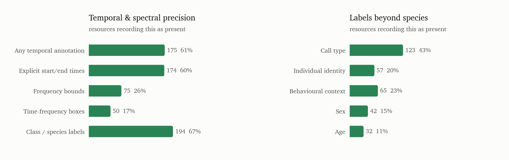
</picture>

| Label type          | yes | partial | no | unknown |
|---------------------|-----|---------|----|---------|
| Call type           | 117 | 6       | 12 | 153     |
| Individual identity | 49  | 8       | 15 | 216     |
| Behavioural context | 56  | 9       | 14 | 209     |
| Sex                 | 38  | 4       | 16 | 230     |
| Age                 | 29  | 3       | 19 | 237     |

Call-type labelling is reasonably common. Individual identity, sex, age and behavioural
context are rare and cluster heavily in captive, laboratory and long-term-field-study
datasets (meerkats, hyenas, marmosets, elephants, rodents) rather than in passive acoustic
monitoring corpora. If you need individual-level supervision, the usable set is small and
almost entirely mammalian.

## 5. Metadata coverage

<picture>
  <source media="(prefers-color-scheme: dark)" srcset="figures/metadata-coverage-dark.png">
  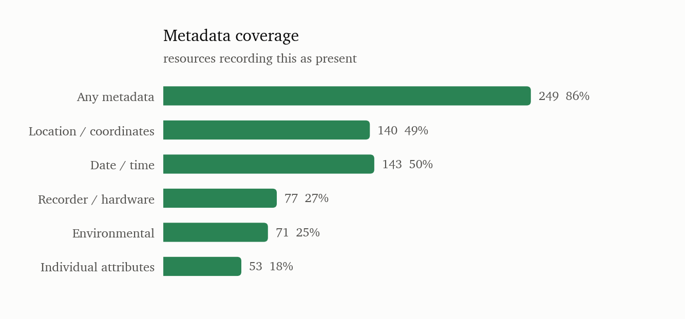
</picture>

| Metadata type            | yes | partial | no | unknown |
|--------------------------|-----|---------|----|---------|
| Any metadata             | 240 | 9       | 0  | 39      |
| Location / coordinates   | 138 | 2       | 5  | 143     |
| Date / time              | 141 | 2       | 2  | 143     |
| Recorder / hardware      | 69  | 8       | 4  | 207     |
| Environmental covariates | 57  | 14      | 12 | 205     |
| Individual attributes    | 49  | 4       | 16 | 219     |

Read the "unknown" column here as *the survey did not record it*, not as *the dataset lacks
it*. Two of the six surveys had no metadata-detail columns at all, so roughly half the rows
could only be scored from free text. Location and date/time are the best-attested; recorder
and hardware metadata are the worst.

## 6. Scale and vintage

<picture>
  <source media="(prefers-color-scheme: dark)" srcset="figures/scale-vintage-dark.png">
  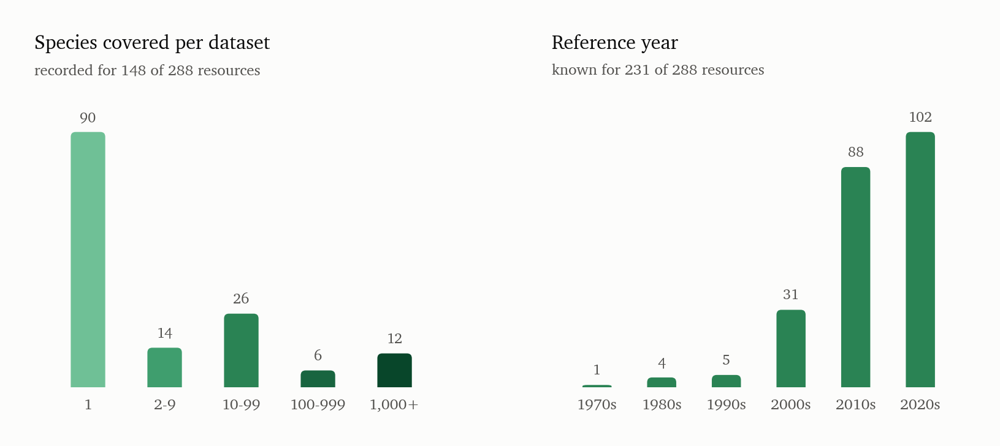
</picture>

Species count is recorded for 148 of 288 resources (median 1, max 11,000).

| Species covered    | datasets | share of those recorded |
|--------------------|----------|-------------------------|
| 1 (single species) | 90       | 61%                     |
| 2–9                | 14       | 9%                      |
| 10–99              | 26       | 18%                     |
| 100–999            | 6        | 4%                      |
| 1,000+             | 12       | 8%                      |

90 of the 148 are single-species datasets — the field's public data is overwhelmingly one
study, one species, one site.

Reference year is known for 231 resources:

| Decade | datasets |
|--------|----------|
| 1970s  | 1        |
| 1980s  | 4        |
| 1990s  | 5        |
| 2000s  | 31       |
| 2010s  | 88       |
| 2020s  | 102      |

## 7. Release status — datasets that may or may not be publicly available

<picture>
  <source media="(prefers-color-scheme: dark)" srcset="figures/release-status-dark.png">
  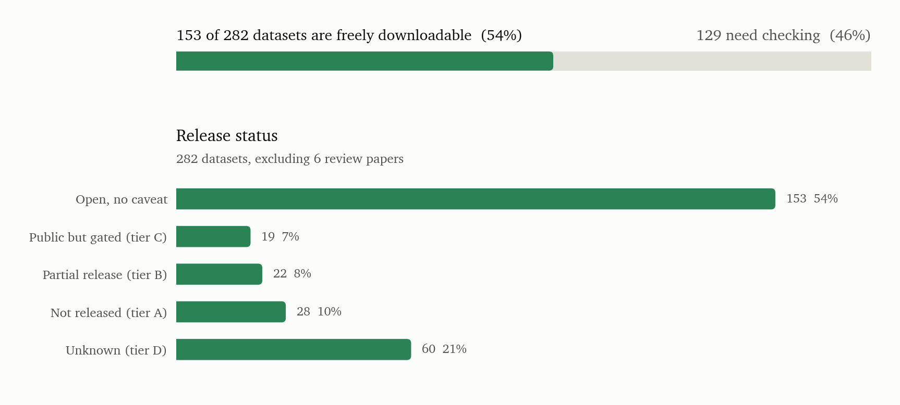
</picture>

This is the section to act on. Counts below are over the 282 datasets, excluding the 6
review papers.

| Status | Datasets | Share |
|---|---|---|
| Publicly available, no access caveat | 153 | 54% |
| Public but with request/registration language (tier C) | 19 | 7% |
| Partial — some subsets open, rest gated (tier B) | 22 | 8% |
| Not publicly released (tier A) | 28 | 10% |
| Release status unknown / unverified (tier D) | 60 | 21% |

So **129 of 282 datasets (46%) cannot be treated as freely downloadable without checking
first.** A further 28 datasets have no access URL of any kind recorded in any survey, and 68
carry explicit "verify / placeholder / unclear" language from the survey that listed them.

16 datasets have **surveys that directly contradict each other** on availability. The
unified file records every such conflict in `notes` (naming which survey said what) and
shows the majority value. Those are the highest-value rows to check by hand.

### Tier A — described as not publicly released (28)

Typically a paper exists and the data is held by the lab or agency. Access means writing to
someone.

| UID       | Dataset                                                        | Primary reference                                       | Stated access route                                                                             |
|-----------|----------------------------------------------------------------|---------------------------------------------------------|-------------------------------------------------------------------------------------------------|
| BIOAC-219 | Alligator / Crocodilian Bellowing Dataset                      | Vliet 1989 – alligator bellowing (American Zoologist);  | Contact Florida Fish & Wildlife; Macaulay Library subset available                              |
| BIOAC-095 | Beluga whale vocalisation dataset                              | Castellote et al. 2012 – Cook Inlet beluga (Endangered  | Contact NOAA AFSC (Robyn Angliss, Manuel Castellote)                                            |
| BIOAC-225 | Big Cat Acoustic Library (Panthera / Zoo datasets)             | Ramsier et al. 2007; Hast 1989 – larynx morphology / so | Contact Panthera.org; some clips via Macaulay Library                                           |
| BIOAC-235 | Common marmoset vocalisation datasets (lab colonies)           | Pistorio et al. 2006; Eliades & Miller 2017 – marmoset  | Contact Princeton Neuroscience Institute (Asif Ghazanfar group)                                 |
| BIOAC-115 | DECAF (Detecting Cetaceans by Acoustics in the Field)          | Rankin et al. 2017 – DECAF (Journal of the Acoustical S | Contact NOAA SWFSC (Julie Oswald)                                                               |
| BIOAC-117 | Dolphin Whistle Contour Dataset (DELPHINID)                    | Oswald et al. 2004 – whistle contours (MEPS); Oswald et | Contact NOAA SWFSC; some via PAMGuard                                                           |
| BIOAC-022 | Egyptian fruit bat vocalization corpus                         | Prat et al. (2017), An annotated dataset of Egyptian fr | Original data described as public in Scientific Data; current Zenodo literature mirror is restr |
| BIOAC-080 | GLIDER / Buoy Fish Sound Monitoring (Atlantic Cod & Haddock)   | Rountree et al. 2006 – fish bioacoustics (Bioacoustics) | Contact NOAA NEFSC / DFO Canada                                                                 |
| BIOAC-081 | Great Barrier Reef Bioacoustics Dataset                        | Lamont et al. 2022 – reef soundscape (Ecological Indica | Contact AIMS (Australian Institute of Marine Science)                                           |
| BIOAC-253 | Great ape vocalization sound-event detection corpora           | Automatic sound event detection for great ape vocalizat | No unified public audio-and-annotation package verified                                         |
| BIOAC-126 | Hawaiian monk seal vocalisation data                           | Rasmussen et al. (2026), Description, Detection, and Cl | Detector outputs/supporting info public; raw data available from authors upon reasonable reques |
| BIOAC-197 | Hear All About It – Passive Acoustic Monitoring Dataset (Hear- | Gibb et al. 2019 – PAM citizen science review (Methods  | Contact Natural England / UKCEH                                                                 |
| BIOAC-199 | JOURDAN / TROPICAL SOUNDSCAPES Dataset (Borneo)                | Jourdan et al. 2023 – SAFE soundscape (Methods in Ecolo | Contact Imperial College London (Jérôme Sueur group) / SAFE Project                             |
| BIOAC-128 | Leopard seal acoustic dataset (Antarctic)                      | Rogers et al. 2009 – leopard seal calls (Journal of Mam | Contact British Antarctic Survey                                                                |
| BIOAC-132 | MBARI DORADO – Dolphin & Porpoise Clicks Dataset               | Roch et al. 2007 – click classification (J. Acoust. Soc | Contact MBARI (Monterey Bay Aquarium Research Institute)                                        |
| BIOAC-138 | MUPUS / DELPHI – Mediterranean Delphinid Survey                | Gannier & Praca 2006; Rendell et al. 1999 – Mediterrane | Contact ACCOBAMS secretariat; some via PAMGuard library                                         |
| BIOAC-263 | Macaque coo-call corpus                                        | Gifford et al. 2003 – macaque coo calls (JASA); Keenan  | Contact authors (Princeton/Max Planck)                                                          |
| BIOAC-143 | NOAA/PMEL SOSUS / Hydrophone Array Long-term Data              | Fox et al. 2002 – fin whale calls SOSUS (J. Acoust. Soc | Contact NOAA PMEL (acoustic monitoring group)                                                   |
| BIOAC-139 | Narwhal Acoustic Dataset (Greenland / Canadian Arctic)         | Koblitz et al. 2016 – narwhal biosonar (PLOS ONE); Blac | Contact DTU Aqua / Greenland Institute of Natural Resources                                     |
| BIOAC-153 | Pygmy/Dwarf Sperm Whale (Kogiidae) Click Dataset               | Hildebrand et al. 2015 – Kogiidae clicks (J. Acoust. So | Contact Scripps / NOAA SWFSC                                                                    |
| BIOAC-155 | ROCCA odontocete call classification training data             | Oswald et al. 2007 – ROCCA (J. Acoust. Soc. Am.)        | Integrated in PAMGuard software; contact NOAA/SWFSC                                             |
| BIOAC-082 | Reef Life Survey Acoustic Dataset (Fish Calls)                 | Parsons et al. 2016 – fish bioacoustics review (Reviews | Contact Scripps Institution of Oceanography / AIMS                                              |
| BIOAC-220 | Sea Turtle Soundscape Dataset                                  | Ferrara et al. 2014 – sea turtle vocalizations (PLOS ON | Contact Dr. Richard Vogt / Instituto Nacional de Pesquisas da Amazônia                          |
| BIOAC-275 | Snow leopard passive acoustic monitoring dataset               | Peters & Bernhammer 1990 – snow leopard sounds; Kaczens | Contact Snow Leopard Trust / Panthera                                                           |
| BIOAC-282 | USCMed rat ultrasonic vocalizations                            | USCMed Dataset – Rat Ultrasonic Vocalizations (2025)    | Public open version (an earlier Zenodo version is restricted)                                   |
| BIOAC-285 | Western lowland gorilla vocalisation data                      | Hedwig et al. 2015 – gorilla chest beats (Scientific Re | Contact Max Planck Institute for Evolutionary Anthropology                                      |
| BIOAC-163 | WhaleMoanDetector training corpus                              | WhaleMoanDetector dataset/model release                 | Restricted/request access                                                                       |
| BIOAC-288 | Yin & McCowan dog bark corpus                                  | Yin & McCowan (2004), Barking in domestic dogs: context | Original audio was obtained by BEANS via personal communication; no open primary repository ver |

### Tier B — partial release: some subsets open, remainder gated (22)

| UID       | Dataset                                                        | Primary reference                                       | Stated access route                                                                        |
|-----------|----------------------------------------------------------------|---------------------------------------------------------|--------------------------------------------------------------------------------------------|
| BIOAC-173 | Bioacoustic Unit Detector (BUDs) / Earth Species Project       | Hagiwara et al. 2022 – BEANS; ESP internal datasets     | —                                                                                          |
| BIOAC-042 | BirdNET Training Data (subset public via xeno-canto)           | Kahl et al. 2021 – BirdNET (Ecological Informatics)     | —                                                                                          |
| BIOAC-096 | Blue whale vocalization dataset (multiple populations)         | Stafford et al. 1999; Sirovic et al. 2004; multiple     | Multiple sub-datasets; some via NCEI; DCLDE challenge data via CETUS                       |
| BIOAC-178 | Cornell Bioacoustics Research Program (BRP) annotated archive  | various Cornell Lab publications                        | Subsets published via Zenodo/Dryad; full archive via collaboration                         |
| BIOAC-116 | DFO Canada Pacific cetacean passive acoustic dataset           | DFO Canada; Williams et al.                             | Some data shared; primarily internal monitoring                                            |
| BIOAC-019 | EchoBank (Global bat echolocation call library)                | Collen 2012 – EchoBank PhD thesis (UCL); Jones et al. 2 | —                                                                                          |
| BIOAC-021 | Ecobat UK bat detector dataset                                 | Newson et al. / BCT                                     | Data accessible via Ecobat platform; some public, some restricted                          |
| BIOAC-122 | Fin whale 20Hz call dataset                                    | Watkins et al. 1987; Stafford et al. 1999               | Various sub-datasets; some via NCEI                                                        |
| BIOAC-056 | Frog call dataset – BirdNET-Analyzer extended (frogs)          | Kahl et al. 2022 (BirdNET); extended to frogs           | BirdNET-Analyzer model weights publicly available; training data largely internal          |
| BIOAC-057 | Hawaiian forest bird monitoring recordings                     | Kahl et al. 2023 – BirdCLEF 2023 (CLEF working notes)   | BirdCLEF 2023 Kaggle competition data                                                      |
| BIOAC-127 | Humpback whale song datasets                                   | Payne & McVay 1971 – humpback songs (Science); Allen et | Multiple sub-datasets; some on Zenodo; some restricted                                     |
| BIOAC-135 | Minke whale Antarctic data (IWC/SORP)                          | SORP; Risch et al. 2013                                 | Collaboration required                                                                     |
| BIOAC-203 | NIPS4B (original challenge)                                    | Glotin et al. 2013 NIPS workshop                        | reported as 'likely' public by source survey. Available via SABIOD lab page; older dataset |
| BIOAC-142 | NOAA PIFSC Pacific Islands cetacean passive acoustic data      | Baumann-Pickering et al. 2013 – species-specific click  | Some data on NCEI; full data via collaboration                                             |
| BIOAC-144 | North Atlantic right whale upcall detection dataset (NOAA NEFS | Davis et al. 2020 – CNN detection NARW (Methods Ecol Ev | NOAA Fisheries / Kaggle 'Marine Mammal Detection' / NCEI                                   |
| BIOAC-148 | Orca Call Library (Center for Whale Research / OrcaLab)        | Ford 1989 – killer whale dialects (Canadian Journal of  | —                                                                                          |
| BIOAC-150 | PAM Guard dataset contributions (multiple species)             | Gillespie et al. 2009; PAMGuard software                | Tethys database contains PAM metadata; audio availability varies                           |
| BIOAC-271 | Pan-African / Congo Basin primate acoustic datasets (PanAf, Co | Kalan et al. 2015 – Pan-African programme; Zuberbühler  | Contact Max Planck Institute for Evolutionary Anthropology (Catherine Crockford group)     |
| BIOAC-209 | SAFE Project acoustic monitoring dataset                       | Ewers et al. 2011; Deichmann et al. 2018                | Registration required; some datasets open                                                  |
| BIOAC-211 | SoundCLEF – Animal Sound Identification (LifeCLEF 2014–2019)   | Joly et al. (annual LifeCLEF papers)                    | Competition data; varies by year                                                           |
| BIOAC-031 | UK Bat Monitoring Programme acoustic data                      | Bat Conservation Trust                                  | Processed acoustic data available on request; raw audio restricted                         |
| BIOAC-162 | Whale FM (Zooniverse citizen science) – killer whale and pilot | Shamir et al. 2014; OrcaLab / WhaleFM project           | Citizen science annotations; some data on Zooniverse                                       |

### Tier C — recorded as public, but the access notes still describe a gate (19)

These are marked available, yet the surveys describe registration, a data agreement, a
request step, or an "authors on reasonable request" clause. Treat as conditionally
available.

| UID       | Dataset                                                        | Primary reference                                       | Stated access route                                                |
|-----------|----------------------------------------------------------------|---------------------------------------------------------|--------------------------------------------------------------------|
| BIOAC-168 | ARBIMON / Automated Remote Biodiversity Monitoring Network arc | Aide et al. 2013 – ARBIMON (PeerJ); Villanueva-Rivera e | Some datasets public via ARBIMON platform; others restricted       |
| BIOAC-165 | Acoustic Observatory Australia (AO)                            | Roe et al. 2021; QUT / Australian rivers                | Registration required; freely accessible after registration        |
| BIOAC-092 | Antarctic blue whale acoustic dataset (IWC / SORP)             | Leroy et al. 2016 – Antarctic blue whale calls (Deep-Se | Australian Antarctic Division                                      |
| BIOAC-011 | Bat Detective / BatDetect2 annotated echolocation calls        | Mac Aodha et al. 2022 – BatDetect2 (PLOS Computational  | Restricted/request access (Zenodo record)                          |
| BIOAC-018 | ChiroVox bat call library                                      | Görföl et al. 2022 – ChiroVox (PLOS ONE)                | Freely accessible; registration may be required for bulk downloads |
| BIOAC-106 | DCLDE 2011 workshop dataset                                    | Moretti et al. 2014 – DCLDE 2011 beaked whale (J. Acous | Available via CETUS project; registration may be required          |
| BIOAC-110 | DCLDE 2018 workshop dataset – low-frequency cetaceans / right  | Urazghildiiev & Clark 2006; Allen et al. 2021 – NARW de | Public workshop datasets; individual subset terms vary             |
| BIOAC-121 | EarthScope / IRIS Seismic + Bioacoustic Dataset                | Dziak et al. 2013 – blue whale infrasound (Earth and Pl | —                                                                  |
| BIOAC-190 | Ecosounds (QUT ecoacoustics archive)                           | Towsey et al.; QUT Ecoacoustics Research Group          | Registration required; data accessible via platform                |
| BIOAC-242 | Elephant Listening Project forest elephant rumble data         | Wrege et al. 2017; Payne et al.                         | Some data shared; contact Cornell Lab; extensive internal archive  |
| BIOAC-243 | ElephantVoices African elephant call repository                | Poole et al. 2011 – ElephantVoices (JASA); Pardo et al. | ElephantVoices Database / Dryad (partial) / Open Science Framework |
| BIOAC-133 | MBARI MARS / SanctSound Pacific Ocean sound archive            | Ryan et al. 2021 – MBARI soundscape ML (Deep-Sea Resear | Contact MBARI (John Ryan, Danelle Cline)                           |
| BIOAC-266 | MeerKAT / Kalahari Meerkat Project annotated vocalisations     | Townsend et al. 2014 – meerkat call types (Animal Behav | Public                                                             |
| BIOAC-152 | Pinniped acoustic datasets (walrus, bearded seal, otariids)    | Sjare & Stirling 1996 – walrus (Journal of Mammalogy);  | Contact NOAA AFSC (Marine Mammals Lab)                             |
| BIOAC-007 | RANA European frog call dataset                                | Dufour et al. 2018 – RANA frog monitoring (Ecological I | Contact authors (IRSTEA/INRAE France)                              |
| BIOAC-157 | Sperm whale click datasets                                     | Rendell & Whitehead 2003 – coda types (Animal Behaviour | Multiple private and partially public sub-datasets                 |
| BIOAC-278 | Spotted hyena vocalisation archive (Mara Hyena Project)        | Holekamp et al.; Mathevon et al. (2010); Dryad Digital  | Dryad / Mara Hyena Project repository / Zenodo                     |
| BIOAC-279 | Taï / Budongo chimpanzee pant-hoot and vocal sequence data     | Crockford et al. 2004 – pant-hoot individuality (Animal | Contact Max Planck Institute for Evolutionary Anthropology         |
| BIOAC-025 | iBats / iBatsID British bat call reference                     | Jones et al. 2013 – iBatsID (Bioacoustics)              | Some summary data available; raw audio restricted                  |

### Tier D — release status unknown or unverified (60)

No survey established whether the data behind these is public. Many are names harvested from
papers without a located repository; several are explicitly flagged by their source survey
as placeholders needing verification.

| UID       | Dataset                                                        | Primary reference                                       | Stated access route                                                                             |
|-----------|----------------------------------------------------------------|---------------------------------------------------------|-------------------------------------------------------------------------------------------------|
| BIOAC-222 | African lion vocalization dataset                              | Grinnell et al. 1995; McComb et al. 1994                | Placeholder – lion acoustic datasets exist but no single public one identified.                 |
| BIOAC-167 | AnimalCLAP pretraining dataset                                 | AnimalCLAP: large-scale audio-language pretraining for  | Included for mammal-inclusive classification coverage; not a strong SED dataset                 |
| BIOAC-093 | Atlantic walrus acoustic dataset                               | Sjare & Smith 1986; Verboom & Kastelein                 | Placeholder – walrus acoustic monitoring exists but public dataset status unclear.              |
| BIOAC-224 | BEANS Dogs individual-vocalization benchmark subset            | BEANS: The Benchmark of Animal Sounds                   | Derived benchmark subset; retained because it adds a domestic-mammal individual-ID task absent  |
| BIOAC-012 | Bat Echo dataset (Zsebok et al.)                               | Zsebok et al. 2020                                      | Placeholder – verify against original paper                                                     |
| BIOAC-016 | Beaked whale echolocation click dataset (Aguilar-Soto / Johnso | Johnson et al. 2004; Aguilar-Soto et al. 2008           | DTAG data is richly annotated but largely restricted. Key beaked whale behavioral acoustics dat |
| BIOAC-094 | Bearded seal call dataset (Van Parijs / NOAA)                  | Van Parijs et al. 2003; Cleator et al.                  | Bearded seal calls well-studied acoustically. No single public dataset identified.              |
| BIOAC-034 | Bioacoustic Event Detection with Source Separation (BIRDSSED)  | Cartwright et al. 2019                                  | Placeholder – verify Cartwright 2019 dataset details.                                           |
| BIOAC-172 | Bioacoustic Unit (BAT) soundscape monitoring (UK)              | Yvon-Durocher et al.; British Ecological Society        | Placeholder – UK soundscape monitoring. Needs verification.                                     |
| BIOAC-036 | Bioscape (Bioacoustic soundscape annotated dataset)            | Jahn et al. / Bioacoustica                              | Placeholder – multiple tropical soundscape SED datasets exist; needs verification.              |
| BIOAC-097 | BlueFinLibrary                                                 | BlueFinLibrary / AcousticTrends source                  | Potential high-value long-duration marine mammal set; exact primary repository should be verifi |
| BIOAC-227 | Bonobo vocalization dataset (MPI Leipzig / Langergraber)       | Genty et al. 2014; Bermejo & Omedes                     | Placeholder – multiple bonobo vocal datasets exist. No single public dataset identified.        |
| BIOAC-229 | Bornean orangutan long call dataset                            | Hardus et al. 2009; Van Schaik et al.                   | Placeholder – orangutan long call PAM growing. No single public dataset identified.             |
| BIOAC-099 | Bowhead whale call dataset                                     | Clark & Johnson 1984; Stafford et al.; various          | Multiple groups have annotated bowhead whale calls; no single public dataset identified.        |
| BIOAC-232 | CatMeows                                                       | Ludovico et al. (2021), CatMeows                        | Open version retained; restricted duplicate Zenodo records omitted during deduplication; Unique |
| BIOAC-233 | Central African Primate Vocalisation Dataset                   | Central African Primate Vocalisation Dataset (2021)     | Included as a mammal classification dataset; access remains unverified                          |
| BIOAC-234 | Close-range vocal interaction in common marmosets              | Miller et al. / Close-range vocal interaction in the co | Strong event labels described in paper; verify raw-audio redistribution terms before use; Uniqu |
| BIOAC-053 | Common cuckoo PAM dataset                                      | various European cuckoo monitoring papers               | Placeholder – cuckoo monitoring programs exist in UK/EU. Verify public dataset.                 |
| BIOAC-101 | Common dolphin whistle dataset                                 | various (Oswald et al.; Roch et al.)                    | Multiple dolphin whistle datasets; no single canonical public dataset identified. DCLDE dataset |
| BIOAC-078 | Coral reef pulsed/tonal call annotations (Moorea / reef acoust | Unsupervised clustering reveals acoustic diversity and  | Included as a potential fish/invertebrate strong-label dataset even though taxonomic IDs are no |
| BIOAC-105 | DCLDE 2011 annotated odontocete whistles                       | Roch et al. (2025 archive), DCLDE 2011 Conference Data: | Primary archival release; older mirrors/BEANS HICEAS packaging overlap; Unique primary/derived  |
| BIOAC-113 | DCLDE 2026 killer whale annotated acoustic dataset             | A Public Dataset of Annotated Orcinus orca Acoustic Sig | Major multi-source marine mammal detection/classification resource; Unique primary/derived pack |
| BIOAC-114 | DCLDE Oahu / odontocete encounters                             | DCLDE Oahu / HICEAS workshop dataset                    | Useful mammal detection dataset but annotation granularity is not uniformly call-level SED; Uni |
| BIOAC-238 | Dingo vocalization dataset                                     | Newsome et al.; Corbett 1995                            | Placeholder – dingo vocalizations documented. No public dataset identified.                     |
| BIOAC-119 | Dominica Sperm Whale Project coda corpus                       | Dominica Sperm Whale Project / coda repertoire datasets | Not a standard SED benchmark, but an important mammal call-classification/communication dataset |
| BIOAC-120 | Dugong vocalization dataset                                    | Anderson & Barclay 1995; Ichikawa et al.                | Dugong vocalizations rarely studied. No public dataset identified.                              |
| BIOAC-054 | East African Bird / Soundscape Dataset                         | Kahl et al. 2024 – BirdCLEF 2024 (CLEF working notes)   | BirdCLEF 2024 focal dataset                                                                     |
| BIOAC-020 | EchoBank / continental-scale European bat reference calls      | Continental-scale European bat acoustic classification  | Classification/reference corpus; may overlap portions of EchoBank source holdings; Unique prima |
| BIOAC-244 | Elk (wapiti) bugle call dataset                                | Kimball et al.; various                                 | Placeholder – elk bugle calls studied acoustically. No public dataset identified.               |
| BIOAC-023 | Eptesicus fuscus ultrasonic vocalization dataset               | unknown                                                 | Placeholder – multiple E. fuscus lab datasets exist                                             |
| BIOAC-248 | Giant otter vocal repertoire dataset                           | Giant otter vocal repertoire study/data                 | Call-classification/repertoire resource, not long-form SED; Unique primary/derived package reta |
| BIOAC-252 | Gombe infant chimpanzee vocalizations                          | Gombe infant chimpanzee vocalization dataset / Plooij-r | Potential dataset; repository details should be re-checked before programmatic download; Unique |
| BIOAC-257 | Hippopotamus vocalization dataset                              | Barklow 2004; Klinck et al.                             | Placeholder – hippo vocalizations studied both above and below water. No public dataset identif |
| BIOAC-258 | Howler monkey vocalization dataset                             | Whitehead 1989; Sekulic 1982; various                   | Placeholder – howler monkey PAM exists but no single public dataset identified.                 |
| BIOAC-259 | HyenaSET                                                       | HyenaSET: Hyena Sound Event Transcripts (2026)          | Largest recent strongly labeled hyena resource found; Unique primary/derived package retained;  |
| BIOAC-260 | Hyrax (rock hyrax) dawn chorus dataset                         | Demartsev et al. 2014; Kershenbaum et al.               | Hyrax songs extensively studied by Kershenbaum lab. Data availability unclear.                  |
| BIOAC-261 | InfantMarmosetsVox                                             | Sarkar & Magimai-Doss (2023), animal caller representat | Processed interface exposes exact event boundaries and labels; Unique primary/derived package r |
| BIOAC-009 | Jumping spider acoustic events (FASD13 task)                   | FASD13 benchmark                                        | Useful non-insect arthropod SED example; Unique primary/derived package retained; overlaps desc |
| BIOAC-088 | Katydid acoustic events (FASD13 task)                          | FASD13 benchmark                                        | Underlying source retained via benchmark when separate release was not resolved; Unique primary |
| BIOAC-262 | Koala vocalization dataset                                     | Phillips & Sheratt; Charlton et al. 2012                | Placeholder – koala PAM increasing. No single public dataset identified.                        |
| BIOAC-264 | Macaque vocalization dataset (Japanese and rhesus macaques)    | Koda et al.; Furuichi et al.; various                   | Placeholder – multiple macaque vocal datasets exist but no single canonical public dataset iden |
| BIOAC-129 | Manatee vocalization dataset                                   | Nowacek et al. 2003; Miksis-Olds et al.                 | Manatee vocalizations studied acoustically. No single public dataset identified.                |
| BIOAC-136 | Minke whale boing detection dataset                            | Rankin & Barlow 2005; Norris et al.                     | Minke whale boing calls characteristic. No single public dataset identified.                    |
| BIOAC-140 | NOAA AFSC Weddell seal call dataset                            | Klinck et al. 2012; Van Opzeeland et al.                | Weddell seals highly vocal under-ice. Multiple groups have annotated calls but no single public |
| BIOAC-028 | North Sea bat acoustic survey dataset                          | van Loon et al. 2011; Ahlen et al.                      | Offshore bat migration monitoring. Public availability unclear.                                 |
| BIOAC-145 | Northern elephant seal vocalization dataset                    | Le Boeuf & Peterson 1969; Van den Berg et al.           | Placeholder – elephant seal calls used for individual ID studies. No public SED dataset identif |
| BIOAC-005 | PARSE (Passive Acoustic Rapid Survey) frog dataset             | Jérôme et al. 2023                                      | Placeholder – frog PAM datasets exist but this specific one needs verification.                 |
| BIOAC-207 | POW (Pool of Widely used soundscapes for bioacoustic SED)      | Cramer et al. 2020                                      | Placeholder – verify against Cramer et al. 2020                                                 |
| BIOAC-069 | PowerBird weakly-supervised bird SED dataset                   | Kahl et al. 2022                                        | Placeholder – verify details.                                                                   |
| BIOAC-272 | Prairie dog vocalization dataset (Con Slobodchikoff lab)       | Slobodchikoff et al. 2009                               | Slobodchikoff lab studies referential signaling in prairie dogs. No public dataset identified.  |
| BIOAC-273 | PrimaVoice primate vocal stimulus set                          | PrimaVoice dataset/stimulus corpus                      | Not a field-monitoring dataset; retained only as mammal classification reference; Unique primar |
| BIOAC-008 | Rana sierrae call dataset (FASD13 source task)                 | FASD13: Few-shot animal sound detection benchmark       | Underlying source not separately identified in this pass; retained because it adds amphibian SE |
| BIOAC-156 | Sei whale call dataset                                         | Baumgartner et al. 2008; Rankin & Barlow                | Sei whale calls well-described. No single public dataset identified.                            |
| BIOAC-212 | SoundscapeDB – annotated soundscape collection                 | Aide et al. 2013 (ARBIMON); various                     | Placeholder – needs verification. Multiple soundscape annotation databases exist.               |
| BIOAC-281 | Thomas's langur / Siamang vocalization dataset                 | Geissmann 1993; various                                 | Placeholder – siamang calls studied bioacoustically. No public dataset identified.              |
| BIOAC-213 | Tropical rainforest bioacoustic dataset (Stowell / QMUL)       | Stowell et al. 2015 / 2016                              | Placeholder – Stowell tropical SED papers. Verify dataset availability.                         |
| BIOAC-283 | Vervet monkey alarm call dataset                               | Seyfarth et al. 1980; Cheney & Seyfarth; various        | Classic primate acoustic dataset. Modern versions may exist. Public availability unclear.       |
| BIOAC-214 | Vocal activity detection dataset – tropical nocturnal soundsca | Aide et al. 2013; related RFCx publications             | Placeholder – tropical nocturnal SED datasets needed. Verify.                                   |
| BIOAC-084 | Wild species-specific fish sounds, Barkley Sound               | Lancaster et al. (2026), Knock knock, who's there?      | Strong candidate for fish SED with unusually good species ground truth; Unique primary/derived  |
| BIOAC-077 | Xenocanto-based multi-species bird SED annotations (Shonfield  | Shonfield & Bayne 2017, Avian Conservation Ecology      | Boreal bird SED from ARU data. Verify public availability.                                      |

### Datasets with no access URL in any survey (28)

African Savanna Soundscapes (Kruger / Serengeti Mammal Audio), Alligator / Crocodilian
Bellowing Dataset, Beluga whale vocalisation dataset, Big Cat Acoustic Library (Panthera /
Zoo datasets), BirdCODE Zero-Shot SED Benchmark & Pretraining Corpora, Common marmoset
vocalisation datasets (lab colonies), DCLDE (Detection, Classification, Localization &
Density Estimation) Marine Mammal Benchmarks, DECAF (Detecting Cetaceans by Acoustics in the
Field), Dolphin Whistle Contour Dataset (DELPHINID), East African Bird / Soundscape Dataset,
GLIDER / Buoy Fish Sound Monitoring (Atlantic Cod & Haddock), Great Barrier Reef
Bioacoustics Dataset, Hawaiian forest bird monitoring recordings, Hear All About It –
Passive Acoustic Monitoring Dataset (Hear-PAD), JOURDAN / TROPICAL SOUNDSCAPES Dataset
(Borneo), Leopard seal acoustic dataset (Antarctic), MBARI DORADO – Dolphin & Porpoise
Clicks Dataset, MBARI MARS / SanctSound Pacific Ocean sound archive, MUPUS / DELPHI –
Mediterranean Delphinid Survey, NOAA/PMEL SOSUS / Hydrophone Array Long-term Data, Narwhal
Acoustic Dataset (Greenland / Canadian Arctic), PowerBird weakly-supervised bird SED
dataset, Pygmy/Dwarf Sperm Whale (Kogiidae) Click Dataset, ROCCA odontocete call
classification training data, Reef Life Survey Acoustic Dataset (Fish Calls), Sea Turtle
Soundscape Dataset, Snow leopard passive acoustic monitoring dataset, Western lowland
gorilla vocalisation data

## 8. Frequency coverage

**What this catalogue can and cannot tell you about call frequency.** It holds no per-call
frequency measurements — it is a catalogue of datasets, not a corpus of annotations — and it
holds no call-*rate* information at all (zero rows mention calls per hour or any equivalent).
What it does carry is each dataset's sampling rate, and the Nyquist limit of that rate
(sampling rate / 2) is the highest frequency the dataset can physically represent. That
ceiling is a sound proxy for which band a dataset targets, and it separates baleen-whale
infrasound from bat and rodent ultrasound cleanly.

<picture>
  <source media="(prefers-color-scheme: dark)" srcset="figures/frequency-coverage-dark.png">
  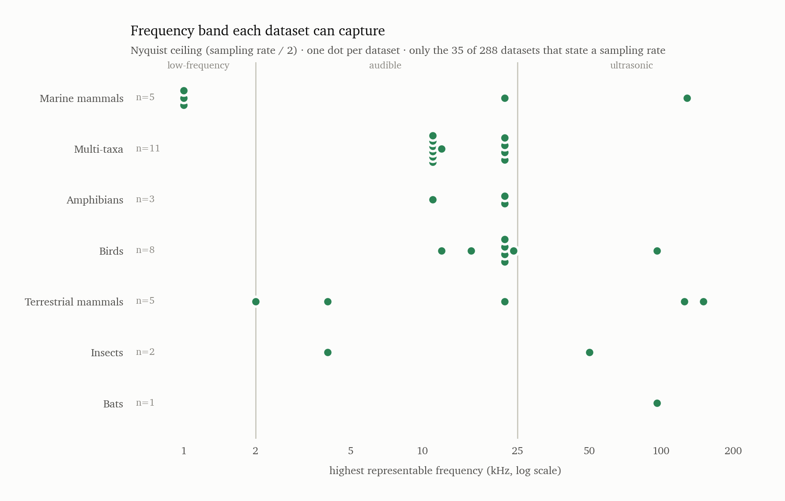
</picture>

| Taxon group         | datasets stating a rate | lowest ceiling | highest ceiling |
|---------------------|-------------------------|----------------|-----------------|
| Multi-taxa          | 11                      | 11.0 kHz       | 22.1 kHz        |
| Birds               | 8                       | 12.0 kHz       | 96.0 kHz        |
| Marine mammals      | 5                       | 1.0 kHz        | 128.0 kHz       |
| Terrestrial mammals | 5                       | 2.0 kHz        | 150.0 kHz       |
| Amphibians          | 3                       | 11.0 kHz       | 22.1 kHz        |
| Insects             | 2                       | 4.0 kHz        | 50.0 kHz        |
| Bats                | 1                       | 96.0 kHz       | 96.0 kHz        |

Only 35 of 288 datasets state a sampling rate, so read this as a sketch of the field's
frequency range rather than a census. Within it, three things stand out.

**The range is enormous — more than two orders of magnitude.** From a 1 kHz ceiling on the
North Atlantic right whale sets (recorded at 2 kHz, because an upcall lives between 50 and
350 Hz) to 150 kHz for mouse ultrasonic vocalisations. No single pipeline handles both ends;
a model trained on one is deaf to the other.

**The mammal groups are bimodal, with nothing in the middle.** Marine mammals sit at 1 kHz
or 128 kHz; terrestrial mammals at 2 kHz (forest elephant rumbles) or 125–150 kHz (rodent
USV). This is the clearest frequency signature in the catalogue: mammal bioacoustics is two
separate technical communities — low-frequency long-range monitoring and high-frequency
close-range recording — that happen to share a taxonomic class.

**The general-purpose datasets cluster in a narrow band.** Every multi-taxa resource sits
between 11 and 22 kHz, because aggregators and benchmarks resample to a common rate
(AudioSet is explicitly "22050 Hz (resampled)"). That ceiling silently discards all bat and
most rodent signal. A cross-taxa benchmark built on those rates cannot represent ultrasound
even when its species list claims to include bats.

### Datasets that state an actual call frequency

Seven datasets name the frequency of the call itself rather than the recorder:

| Dataset | Stated call frequency |
|---|---|
| Fin whale 20 Hz call dataset | 20 Hz |
| NOAA HARP blue/fin whale monitoring | 20 Hz pulses |
| DCLDE 2015 low-frequency blue and fin whale | 20 Hz pulses |
| WhaleMoanDetector training corpus | 20 / 40 Hz call types |
| MBARI MARS / SanctSound | 40 Hz calls |
| North Atlantic right whale upcall detection | 50–350 Hz |
| ElephantVoices African elephant repository | infrasound, down to 10–20 Hz |

All seven are low-frequency. That is not a sampling accident: the baleen-whale and elephant
communities name their calls by frequency ("the 20-Hz pulse"), so the number ends up in the
dataset description. Bat and rodent work states recording bandwidth instead (192–500 kHz,
250–384 kHz), and bird work states neither.

### Where the real distributions are

If you want actual call-frequency distributions rather than this dataset-level sketch, they
exist — inside the annotation files, not the catalogue. **48 datasets carry per-call
time-frequency bounding boxes, and 34 of those are public**: every box has a low and high
frequency per annotated call, which is exactly the raw material for a distribution.

| Taxon group | public, box-annotated datasets |
|---|---|
| Birds | 14 |
| Marine mammals | 10 |
| Terrestrial mammals | 6 |
| Multi-taxa | 2 |
| Bats | 1 |
| Insects | 1 |

The largest single source is WABAD (90,662 bird vocalisations with lower and upper frequency
per box). Filter the unified CSV on `bounding_boxes = yes` and `publicly_available = yes` to
get the full list with access URLs.

### The measured distribution

The section above is a proxy. The real distributions live inside the annotation files, so
`make_frequency_distribution.py` fetches them (annotations only, never audio) from seven
public datasets that record a low and high frequency per call, and plots where those calls
actually sit. **197,686 annotated calls.**

<picture>
  <source media="(prefers-color-scheme: dark)" srcset="figures/frequency-distribution-dark.png">
  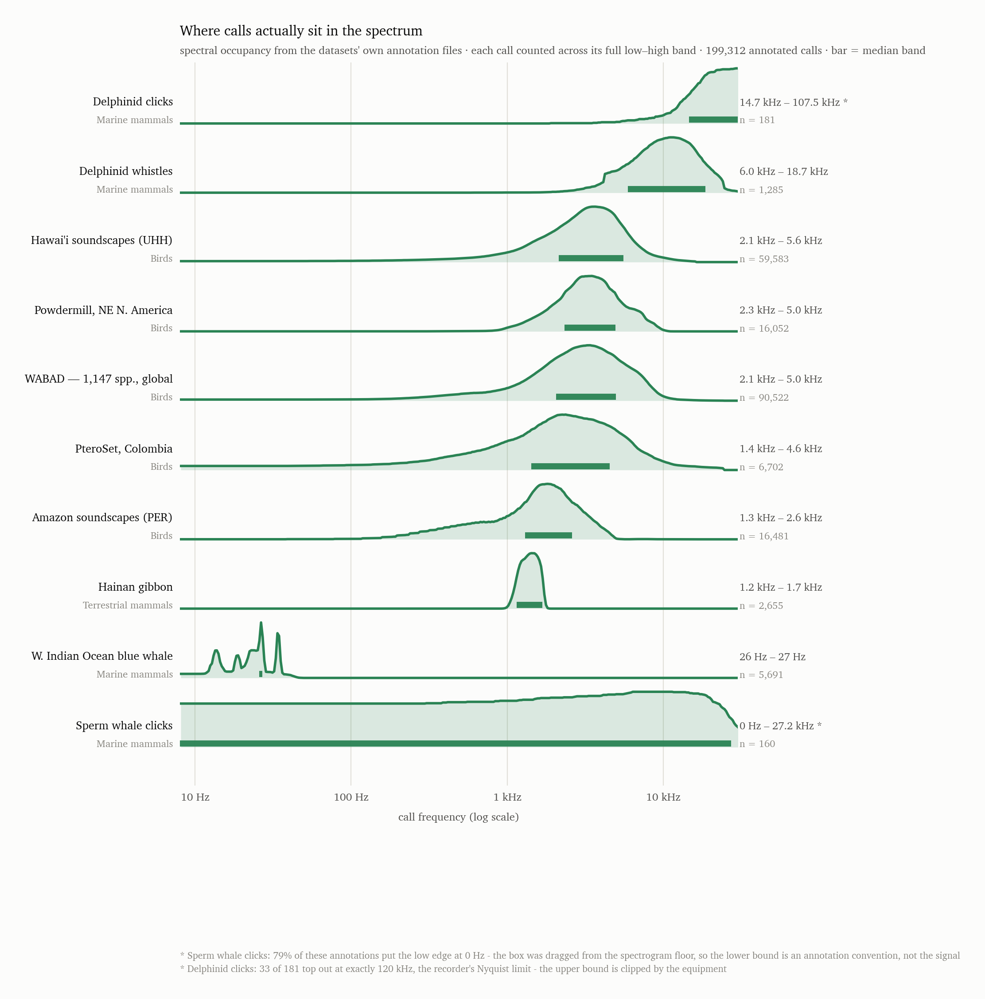
</picture>

| Dataset | Taxon | Median call band | Calls |
|---|---|---|---|
| W. Indian Ocean blue whale | Marine mammals | 26 – 27 Hz | 5,691 |
| Hainan gibbon | Terrestrial mammals | 1.2 – 1.7 kHz | 2,655 |
| Amazon soundscapes (PER) | Birds | 1.3 – 2.6 kHz | 16,481 |
| PteroSet, Colombia | Birds | 1.4 – 4.6 kHz | 6,702 |
| WABAD (1,147 spp., global) | Birds | 2.1 – 5.0 kHz | 90,522 |
| Hawai'i soundscapes (UHH) | Birds | 2.1 – 5.6 kHz | 59,583 |
| Powdermill, NE N. America | Birds | 2.3 – 5.0 kHz | 16,052 |

Each call is an interval, not a point, so a call is counted in every bin its band overlaps:
the curves are spectral *occupancy*, normalised to each dataset's own peak.

**Blue whale calls are almost a pure tone.** The median band is 26–27 Hz — a single hertz
wide — and the whole distribution fits between roughly 15 and 40 Hz, with distinct spikes for
the separate call types. Nothing else in this comparison is remotely so narrow, and it is two
orders of magnitude below every bird dataset. A detector built for this is solving a
different problem from a bird SED model, not a harder version of the same one.

**Bird datasets converge on 1–6 kHz regardless of continent.** Hawai'i, Powdermill, the
global WABAD pool, Colombia and the Amazon all peak between 2 and 4 kHz. The agreement across
a Pacific island, temperate North America, the Andes and Amazonia is the strongest regularity
in this whole catalogue — it is avian anatomy, not sampling. The Amazon set is the one that
sits lower and tighter (median 1.3–2.6 kHz), consistent with lowland forest favouring
lower-frequency transmission.

**The gibbon is a narrow band inside the bird range.** Median 1.2–1.7 kHz, and its occupancy
curve is a single sharp peak rather than a hump — a stereotyped song, unlike the broad mix of
species and call types in a soundscape corpus. Frequency alone will not separate gibbon song
from the birds calling over it.

**What is missing from this per-dataset view.** There is no bat, rodent or insect row here.
The insect gap has since been closed — reading a katydid corpus's selection tables out of a
2.4 GB archive over HTTP Range, without downloading it, is covered in the next section — but
the ultrasonic mammal gap has not. Bat Detective and the European bat reference set are
access-restricted; the human-verified bat library ships as a single 2.1 GB `.7z`;
ChirosetEurope's manifest carries sampling rate but no per-call frequency.

### The same calls, pooled by taxonomic group

The figure above is one row per dataset. Pooling the same measurement by taxonomic group
asks a different question — what does a *bird* call look like, against a *whale* — and makes
the empty rows meaningful, because a group with no row is a group no dataset has published a
per-call frequency for. `make_frequency_by_taxon.py` builds it from both harvests.
**215,389 annotated calls, 13 sources, 5 of 7 groups.**

<picture>
  <source media="(prefers-color-scheme: dark)" srcset="figures/frequency-by-taxon-dark.png">
  
</picture>

| Group | Calls | Sources | Datasets in catalogue | Where occupancy peaks |
|---|---|---|---|---|
| Birds | 189,875 | 6 | 54 | 1.5 – 6.2 kHz |
| Marine mammals | 10,898 | 5 | 77 | 13 – 35 Hz, plus a second mode near 6–20 kHz |
| Insects | 11,961 | 1 | 6 | 9.6 – 19.9 kHz **+** 22.4 – 33.0 kHz |
| Terrestrial mammals | 2,655 | 1 | 78 | 1.1 – 1.7 kHz |
| Bats | — | — | 37 | no per-call frequency published |
| Amphibians | — | — | 8 | no per-call frequency published |
| Fish | — | — | 8 | no per-call frequency published |

**Birds are the one group with a single, stable answer.** Six corpora from a Pacific island,
temperate North America, the Andes, Amazonia, a global pooled set and a captive zebra finch
colony all land inside 1.5–6.2 kHz, and the faint per-source lines sit almost on top of one
another. No other group looks like this.

**Marine mammals are not one distribution, they are two.** The pooled curve has a spiky mode
at 13–35 Hz — blue and fin whale notes, each call type a separate spike — and a second broad
mode two and a half orders of magnitude higher for delphinid whistles and clicks, reaching
past 100 kHz. The bar marks only the lower mode because the curve is call-weighted and the
baleen corpora are 80% of the calls. Read the faint lines, not the bar, for this row. There
is no single frequency band for "marine mammals," and a model trained on one mode has no
purchase on the other.

**Three of seven groups have nothing at all**, and they are not small corners of the
catalogue: **bats are 37 datasets**, fish 8, amphibians 8. Bats are the sharpest case, since
they are also 51% of all mammal audio files. The datasets exist and are large; what is
missing is an annotation file with a frequency column that anyone can reach. This is the
access problem of section 7 appearing as a measurement gap.

**A caution about frequency columns that are not measurements.** Four sources were harvested,
parsed cleanly, and then excluded because every row carried the *same* band — the humpback
whale (2,890 rows all 100–4,900 Hz), AnuraSet frogs (1,773 all 100–10,925 Hz), meerkats
(1,294 all 100–3,900 Hz) and rat USVs (296 all 18–30 kHz). Those columns hold the corpus's
stated range copied onto each row, not a measurement of each call, and pooling them would
have drawn a rectangle and called it a distribution. Three of the four come from one
benchmark's repackaging, which is a detection benchmark and does not claim otherwise; the
lesson is that a populated frequency column is not evidence of a frequency measurement.
Amphibians would have had a row on the strength of that data, and should not.

Two smaller filters apply throughout. A box whose low edge is exactly 0 Hz was dragged from
the bottom of the spectrogram rather than around a call — 126 of the 160 sperm whale boxes,
which removes that row entirely — and a box whose high edge sits exactly at the recording's
Nyquist limit was dragged to the top, as 2,309 of the zebra finch boxes were at 22,050 Hz.
Both are conventions, not bounds, and both are dropped; the Nyquist test fires only when that
exact value repeats across more than 5% of a source's boxes, so a corpus with a few genuine
calls at its ceiling keeps them.

### A frequency range for every dataset, and the evidence for it

The two figures above use whichever datasets happen to publish per-call frequencies. This
asks the question of **all 288**: what band does this dataset cover, and how do we know?

The catalogue cannot answer it. **No dataset states a frequency range in any field**, and only
31 give a numeric sampling rate; the rest say "various" or nothing. So `measure_spectra.py`
goes to the audio — sampling four files per archive over HTTP Range, never downloading an
archive whole — and `make_frequency_table.py` assembles everything into
`frequency_ranges.csv`, one row per dataset, cheapest evidence last:

| Evidence | Datasets | What the number is |
|---|---|---|
| `annotations` | 18 | a low and a high read per call from the dataset's own annotation file — the band of the calls |
| `audio-clip` | 5 | 5–95% energy band of sampled audio where one file is about one call |
| `audio-cont` | 4 | the same, from continuous recording: the band of everything the microphone heard |
| `audio-noisy` | 8 | measured, but stationary low-frequency noise set the result — read the upper edge only |
| `nyquist` | 31 | stated sampling rate: an upper bound, and no lower bound at all |
| `none` | 222 | nothing establishable |

| Dataset | Group | Evidence | Band | Peak | Sampled |
|---|---|---|---|---|---|
| Free-ranging odontocete acoustic recordings fr | Marine mammals | annotations | 5.6 kHz – 21.7 kHz | — | 769 calls |
| CESCAB ocean-glider cetacean acoustic dataset | Marine mammals | annotations | 6.3 kHz – 19.6 kHz | — | 1,431 calls |
| Barro Colorado Island katydid soundscape annot | Insects | annotations | 13.8 kHz – 19.6 kHz | — | 11,961 calls |
| Overlapping Zebra Finch vocalization dataset | Birds | annotations | 1.3 kHz – 17.5 kHz | — | 2,673 calls |
| Colombia & Costa Rica fully annotated soundsca | Birds | annotations | 1.8 kHz – 8.0 kHz | — | 6,908 calls |
| Sapsucker Woods fully annotated soundscapes (S | Birds | annotations | 1.6 kHz – 6.6 kHz | — | 41,264 calls |
| High Sierra Nevada soundscapes (HSN) | Birds | annotations | 4.1 kHz – 6.1 kHz | — | 10,972 calls |
| Southern Sierra Nevada fully annotated soundsc | Birds | annotations | 4.1 kHz – 6.1 kHz | — | 10,972 calls |
| Hawaiian Islands fully annotated soundscapes ( | Birds | annotations | 2.2 kHz – 5.6 kHz | — | 58,770 calls |
| WABAD: World Annotated Bird Acoustic Dataset | Birds | annotations | 2.1 kHz – 5.0 kHz | — | 89,513 calls |
| Powdermill / Eastern North American birds anno | Birds | annotations | 2.3 kHz – 5.0 kHz | — | 16,043 calls |
| PteroSet | Birds | annotations | 1.5 kHz – 4.6 kHz | — | 6,406 calls |
| Southwestern Amazon Basin fully annotated soun | Birds | annotations | 1.3 kHz – 2.6 kHz | — | 16,470 calls |
| Gibbon song datasets (Bornean / Southeast Asia | Terrestrial mammals | annotations | 1.2 kHz – 1.7 kHz | — | 2,655 calls |
| Black-and-white ruffed lemur passive-acoustic  | Terrestrial mammals | annotations | 388 Hz – 1.3 kHz | — | 405 calls |
| Spotted seal vocal behavior dataset | Marine mammals | annotations | 64 Hz – 504 Hz | — | 160 calls |
| TemporalContext-2021-FinWhale | Marine mammals | annotations | 11 Hz – 37 Hz | — | 3,018 calls |
| Western Indian Ocean blue whale call annotatio | Marine mammals | annotations | 26 Hz – 27 Hz | — | 5,680 calls |
| ChirosetEurope | Bats | audio (clips) | 91.7 kHz – 108.0 kHz | 106.1 kHz | 8 files |
| VOCAPRA goat vocalization dataset | Terrestrial mammals | audio (clips) | 424 Hz – 3.2 kHz | 672 Hz | 4 files |
| CatMeows | Terrestrial mammals | audio (clips) | 744 Hz – 2.2 kHz | 1.4 kHz | 4 files |
| CowRumIA bovine vocalization dataset | Terrestrial mammals | audio (clips) | 199 Hz – 1.6 kHz | 580 Hz | 4 files |
| Soundwel labeled pig vocalization repository | Terrestrial mammals | audio (clips) | 64 Hz – 618 Hz | 137 Hz | 4 files |
| Common marmoset vocalisation datasets (lab col | Terrestrial mammals | audio (continuous) | 7.7 kHz – 9.2 kHz | 5.0 Hz | 4 files |
| Dog-human social play vocalization dataset | Terrestrial mammals | audio (continuous) | 66 Hz – 4.5 kHz | 349 Hz | 4 files |
| AnuraSet | Amphibians | audio (continuous) | 1.2 kHz – 3.3 kHz | 1.9 kHz | 4 files |
| Jumping spider acoustic events (FASD13 task) | Arachnids | audio (continuous) | 86 Hz – 2.0 kHz | 159 Hz | 4 files |
| North Atlantic right whale upcall detection da | Marine mammals | audio (noise-dominated) | 41 Hz – 12.7 kHz | 8.0 Hz | 4 files |
| Rana sierrae call dataset (FASD13 source task) | Amphibians | audio (noise-dominated) | 16 Hz – 8.5 kHz | 12 Hz | 4 files |
| Katydid acoustic events (FASD13 task) | Insects | audio (noise-dominated) | 12 Hz – 7.4 kHz | 12 Hz | 4 files |
| MarmAudio | Terrestrial mammals | audio (noise-dominated) | 12 Hz – 7.2 kHz | 12 Hz | 4 files |
| Southern yellow-cheeked crested gibbon PAM ben | Terrestrial mammals | audio (noise-dominated) | 13 Hz – 5.1 kHz | 14 Hz | 4 files |
| Hainan gibbon PAM annotations (original releas | Terrestrial mammals | audio (noise-dominated) | 7.0 Hz – 2.1 kHz | 9.0 Hz | 4 files |
| Humpback whale song datasets | Marine mammals | audio (noise-dominated) | 9.0 Hz – 1.9 kHz | 30 Hz | 4 files |
| USCMed rat ultrasonic vocalizations | Terrestrial mammals | audio (noise-dominated) | 49 Hz – 915 Hz | 92 Hz | 4 files |

**The bat gap is closed.** ChirosetEurope measures **91.7–108 kHz**, peak 106 kHz, on audio
sampled at 500 kHz — the only ultrasonic measurement in the catalogue, and the first row bats
have had in any of these figures. Getting it required catching a trap: three of the first four
files sampled were **10x time-expanded**, a bat-detector convention that divides every
frequency by ten and put *Myotis* echolocation at 4 kHz. The manifest flags which 1,595 of the
11,517 files are expanded, so the measurement now skips them rather than correcting them.

**Two groups appear for the first time**, both out of the FASD13 few-shot benchmark, which
packages one small archive per taxon and is by far the cheapest route into taxa nothing else
exposes: **jumping spiders at 86 Hz – 2.0 kHz** and **AnuraSet frogs at 1.2 – 3.3 kHz**.

**Measuring a call band from raw audio failed for 8 of 17 datasets, and the failures are
systematic.** It works on close-range, high-SNR clip corpora — cats, goats, pigs, cattle, bats
— and fails on field and colony recordings, where wind, water flow and handling noise dominate
the spectrum: MarmAudio came out peaking at 12 Hz, the Hainan gibbon PAM release at 9 Hz, and
USCMed's rat ultrasonic vocalizations at **49–915 Hz on audio sampled at 250 kHz**, when the
calls are at 22–80 kHz. Nobody samples at 250 kHz to capture a 900 Hz signal, so the sampling
rate is itself evidence that the measurement missed. I tried two fixes — weighting each
frequency bin by how far its loud moments rise above its own median, and subtracting each
bin's noise floor — and **neither helped**, because low-frequency noise is transient too.
Those rows are flagged rather than quietly reported, on two mechanical tests: a lower edge at
the 5 Hz analysis floor, or a spectral peak below 100 Hz on a wideband recording whose band
also reaches into the rumble.

The qualifier in that second test matters. The FASD13 marmoset files put 90% of their energy
in **7.7–9.2 kHz**, which is right for phee calls, while one low bin still holds the single
highest value. Flagging on the peak alone would have thrown away a good measurement, so a
rumble peak only condemns a row when the band itself reaches down into the rumble.

**A duplicate found on the way.** Zenodo records 7525804 and 7525805 are byte-identical in all
five files — same MD5 for the annotations, the species list, the location file, the PDF and
the 1.4 GB audio archive. BIOAC-061 "High Sierra Nevada" and BIOAC-072 "Southern Sierra Nevada"
are therefore one dataset deposited twice, which is why they report an identical 4.1–6.1 kHz
band over an identical 10,972 calls. Both rows carry the note; the calls are counted once.

**What this leaves.** 35 of 288 datasets now have a measured band and 31 more have a Nyquist
ceiling, so **222 datasets — 77% — still have no frequency information of any kind.** Almost
all of them are the datasets that are hard to reach at all: Dryad's programmatic downloads are
blocked, several Zenodo records are restricted or cite the wrong DOI, and the large monitoring
archives require a collaboration agreement. Frequency coverage in this catalogue is a
downstream symptom of access, not of the science.

## 9. Data-quality problems found while merging

These are defects in the source surveys, surfaced by reconciling them. Worth knowing before
trusting any single survey.

- **Wrong DOIs attached to the wrong datasets.** One survey cites Zenodo `10.5281/zenodo.7078499`
  — the Hawaiian Islands (UHH) annotated soundscapes — as the access DOI for *freefield1010*,
  *warblrb10k* and the *Bird Audio Detection challenge*. Another attaches the BirdVox-DCASE-20k
  DOI to BirdVox-full-night. Identifier-based deduplication alone would have silently fused
  unrelated datasets.
- **The same dataset under three unrelated names.** Chronister et al. (2021) appears as
  "POWDERMILL", as "Eastern North American birds / ENA / Enabirds", and as the BirdSet "POW"
  evaluation subset — in two different surveys, one of which lists it twice. Reported sizes for
  it differ by a factor of four (~6.4 h vs ~25 h / ~12,000 annotations).
- **Umbrella benchmarks double-counted with their constituents.** DCASE Task 5, FASD13, BEANS,
  BirdSet and the DCLDE series each appear both as a whole and as their component datasets.
  The unified file keeps both but cross-references them; sizes must not be summed across an
  umbrella row and its constituents.
- **Self-flagged placeholders.** 68 rows carry "placeholder — verify", "needs
  verification" or similar from their own survey. Two rows in one survey ("POW (Pool of Widely
  used soundscapes)" and "PowerBird") look like hallucinated expansions of benchmark codes.
- **Availability disagreements.** 16 datasets are called public by one survey and
  restricted by another. Across all structured fields, 57 merged rows carry at least
  one recorded survey-vs-survey conflict.
- **Task labels that contradict the label structure.** Several rows are described as sound
  event detection while their own annotation fields record clip-level binary labels only.

## 10. Reading the unified file

- `taxonomic_scope`, `annotation_task`, `strong_or_weak_labels`, `terrestrial_or_marine` and
  `publicly_available` are normalised to controlled vocabularies. The original survey wording
  is preserved in `taxonomic_group`, `associated_tasks` and `access_notes`.
- Tri-state fields (`bounding_boxes`, `sex_labels`, `recorder_metadata`, …) use
  `yes` / `partial` / `no` / `unknown`. On a merge the value is the majority across the surveys
  that recorded one (ties resolve toward the more informative value), and any disagreement is
  written into `notes`. `unknown` means no survey recorded it, not that the dataset lacks it.
- `notes` carries merge rationale (`MERGED from N survey rows …`), deliberate
  non-merge decisions (`RELATED: …`), and availability disagreements.
- `source_surveys` gives full provenance back to the source file and row.
- Every chart ships with the table it was drawn from, and the tables are authoritative — if a
  figure fails to load, nothing in this document is lost. Charts come in light and dark
  variants and follow the viewer's theme; a single-series chart carries no legend because its
  title names what is plotted.
