# Mammal bioacoustic datasets — subset analysis

The same figures as `bioacoustic_datasets_summary.md`, restricted to the **165
mammal-dedicated resources** in `bioacoustic_datasets_unified.csv` — every row whose
normalised `taxonomic_scope` is *Marine mammals*, *Terrestrial mammals* or *Bats*.

**Scope note.** A further 35 multi-taxa resources also contain mammal audio (AudioSet, GBIF,
iNaturalist, BEANS, the DCASE Task 5 series, Macaulay and similar), and they are **not**
counted here. They are aggregators and cross-taxa benchmarks whose hosting, licensing and
label properties describe the aggregator rather than its mammal content, so folding them in
would distort every distribution below. Section 2 of the main report covers them.

Counts here are one row per resource, so unlike the main report's taxon chart they sum to
165.

## 1. Which mammals

<picture>
  <source media="(prefers-color-scheme: dark)" srcset="figures/mammals/taxa-dark.png">
  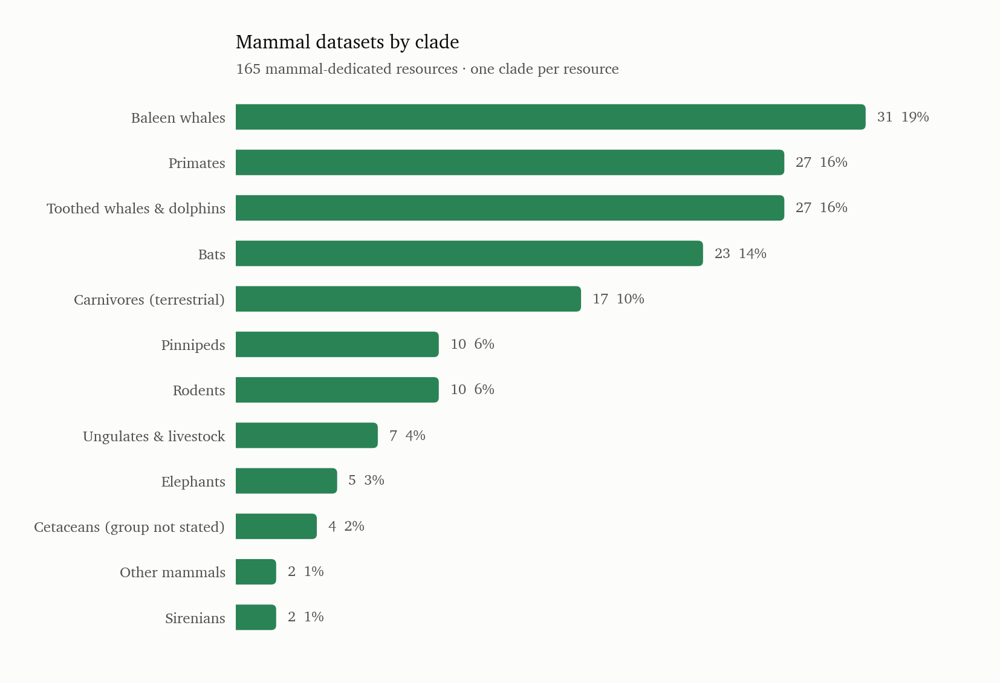
</picture>

| Clade                        | resources | share |
|------------------------------|-----------|-------|
| Baleen whales                | 31        | 19%   |
| Primates                     | 27        | 16%   |
| Toothed whales & dolphins    | 27        | 16%   |
| Bats                         | 23        | 14%   |
| Carnivores (terrestrial)     | 17        | 10%   |
| Pinnipeds                    | 10        | 6%    |
| Rodents                      | 10        | 6%    |
| Ungulates & livestock        | 7         | 4%    |
| Elephants                    | 5         | 3%    |
| Cetaceans (group not stated) | 4         | 2%    |
| Other mammals                | 2         | 1%    |
| Sirenians                    | 2         | 1%    |

Cetaceans are the single largest block: baleen whales, toothed whales and the four
group-unstated cetacean rows total 62 resources, 38% of all mammal datasets. Add pinnipeds
and sirenians and marine mammals alone are 74 of 165.

Primates (27) and bats (23) are the terrestrial heavyweights. Everything else is thin:
rodents and pinnipeds 10 each, ungulates and livestock 7, elephants 5, sirenians 2.

*Cetaceans (group not stated)* is a bookkeeping bar, not a clade — resources that say
"cetacean" or "marine mammal" without naming whether they are baleen or toothed. *Other
mammals* is the rock hyrax and koala datasets.

## 2. Survey overlap

<picture>
  <source media="(prefers-color-scheme: dark)" srcset="figures/mammals/survey-overlap-dark.png">
  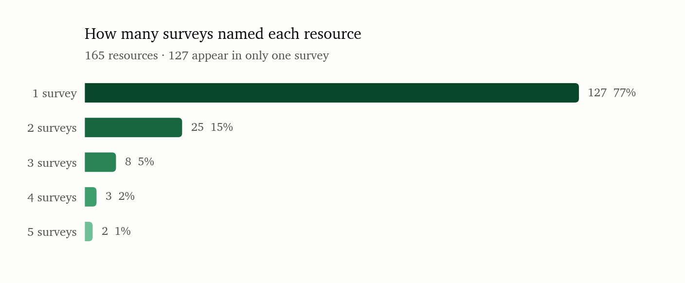
</picture>

| Named by  | resources | share |
|-----------|-----------|-------|
| 1 survey  | 127       | 77%   |
| 2 surveys | 25        | 15%   |
| 3 surveys | 8         | 5%    |
| 4 surveys | 3         | 2%    |
| 5 surveys | 2         | 1%    |

## 3. Hosting and licensing

<picture>
  <source media="(prefers-color-scheme: dark)" srcset="figures/mammals/hosts-licence-dark.png">
  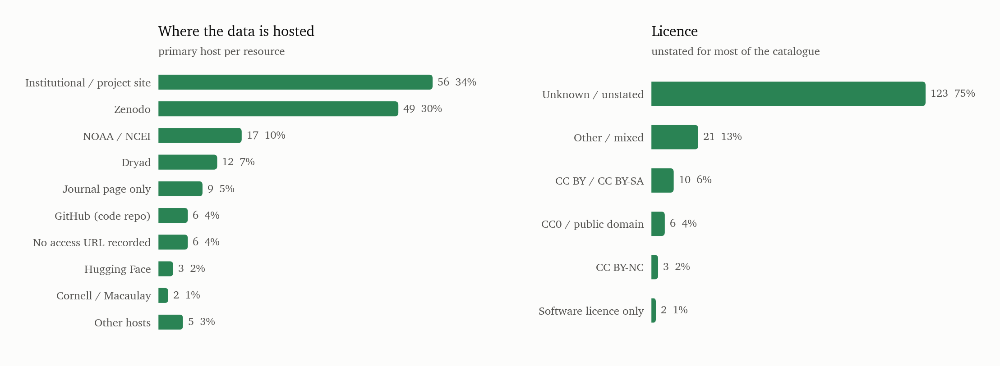
</picture>

| Primary host                 | resources | share |
|------------------------------|-----------|-------|
| Institutional / project site | 56        | 34%   |
| Zenodo                       | 49        | 30%   |
| NOAA / NCEI                  | 17        | 10%   |
| Dryad                        | 12        | 7%    |
| Journal page only            | 9         | 5%    |
| GitHub (code repo)           | 6         | 4%    |
| No access URL recorded       | 6         | 4%    |
| Hugging Face                 | 3         | 2%    |
| Cornell / Macaulay           | 2         | 1%    |
| Other hosts                  | 5         | 3%    |

| Licence               | resources | share |
|-----------------------|-----------|-------|
| Unknown / unstated    | 123       | 75%   |
| Other / mixed         | 21        | 13%   |
| CC BY / CC BY-SA      | 10        | 6%    |
| CC0 / public domain   | 6         | 4%    |
| CC BY-NC              | 3         | 2%    |
| Software licence only | 2         | 1%    |

## 4. Labels

<picture>
  <source media="(prefers-color-scheme: dark)" srcset="figures/mammals/annotation-task-dark.png">
  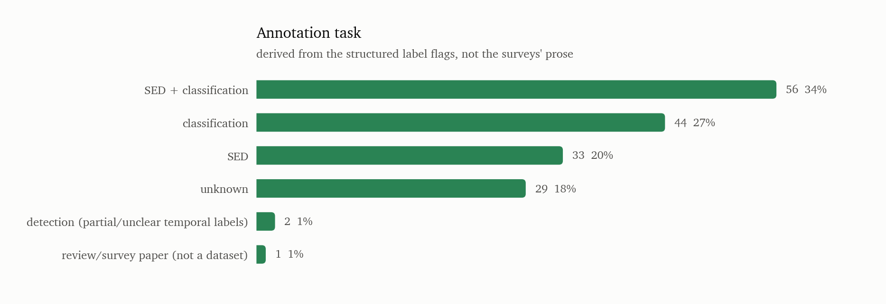
</picture>

| Task                                        | resources | share |
|---------------------------------------------|-----------|-------|
| sound event detection + classification      | 56        | 34%   |
| classification                              | 44        | 27%   |
| sound event detection                       | 33        | 20%   |
| unknown                                     | 29        | 18%   |
| detection (partial/unclear temporal labels) | 2         | 1%    |
| review/survey paper (not a dataset)         | 1         | 1%    |

<picture>
  <source media="(prefers-color-scheme: dark)" srcset="figures/mammals/label-coverage-dark.png">
  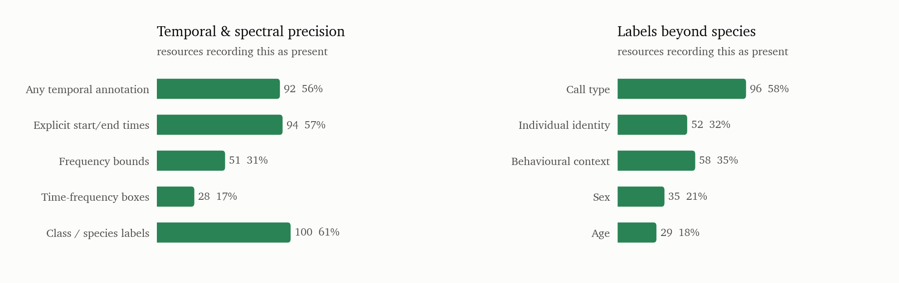
</picture>

### Volume of audio behind each annotation type

Dataset counts say nothing about how much audio each type carries, so this is the same split
three ways: by files, by hours, and by dataset count, across the **147 mammal datasets whose
annotation type is known**. The 14 corrections from opening the data (below) are applied
here. The 17 still-unresolved datasets are excluded: only 2 of them state a file count, so
including them showed a 0.1% slice that read as *tiny* when the truth is *unmeasured*.

<picture>
  <source media="(prefers-color-scheme: dark)" srcset="figures/mammals/volume-by-annotation-type-dark.png">
  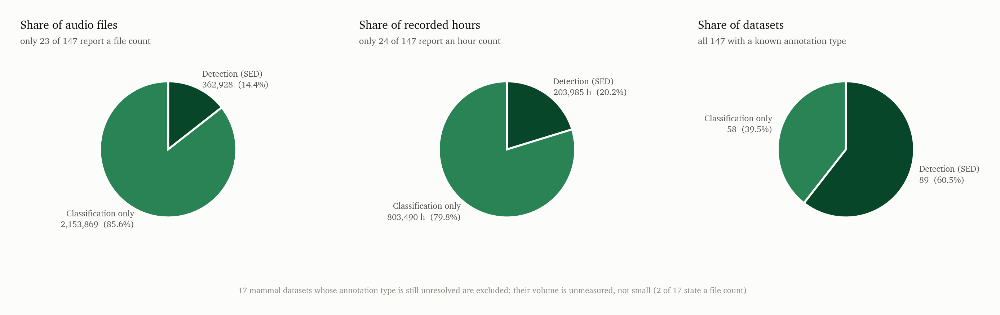
</picture>

| Annotation type      | datasets | share | audio files | reporting | hours   | reporting |
|----------------------|----------|-------|-------------|-----------|---------|-----------|
| Detection (SED)      | 89       | 61%   | 362,928     | 8/89      | 203,985 | 17/89     |
| Classification only  | 58       | 39%   | 2,153,869   | 15/58     | 803,490 | 7/58      |
| *(excluded)* Still unresolved | 17 | — | 1,262 | 2/17 | 1,880 | 1/17 |

**The three pies disagree, and that is the finding.** Detection is the clear majority of
mammal datasets — 61% of those with a known annotation type — but only 14% of the files and
20% of the hours. Classification is the minority of datasets and the overwhelming majority of
the audio. Counting datasets tells you what the field has *built*; counting hours tells you
where the *audio* is, and the two answers are inverted.

**Why the unresolved 17 are excluded.** Before opening the datasets, that bucket looked like
31 datasets holding 981,378 files — 37% of everything — which suggested a large pool of
uncharacterised audio. Almost all of it was MarmAudio's 871,044 clips, which carry call-type
labels in an `Annotations.tsv` no survey had read. After the corrections the bucket is 17
datasets and 1,262 files, but that is not a measurement: only 2 of the 17 state a file count
at all, and 1 states an hour count. Plotted, it rendered as a 0.1% sliver that invites the
reading *these datasets are tiny* when the truth is *nobody has recorded how big they are*.
Leaving them out makes the comparison one between quantities that were actually measured.

**Read the coverage columns before the volume pies.** Only 25 of 164
mammal datasets state a file count and 25 state an hour count, because the catalogue's size
field is prose — most rows give annotated calls, events, encounters, deployment-days or
gigabytes instead. Counts here were only taken when a number was attached to a file-like
noun (files, recordings, clips, sequences, tapes); calls, events and annotations were
ignored.

The two units disagree on purpose, and the disagreement is the point. **Detection datasets
look small in files and large in hours**, because they are continuous passive-acoustic
recordings that nobody counts in files — 14% of files but 20% of hours, and their reported
hours come from 17 datasets against only 9 reporting files. **Classification datasets look
large in files** because they are pre-segmented clip corpora, which is the unit they
naturally report.

Both charts are also highly concentrated. Three long-term archives — Ocean Networks Canada
(500,000 h), MERIDIAN/MBARI (200,000 h) and NOAA PIFSC (100,000 h) — supply essentially all
800,000 hours in the classification slice, and they are long-term monitoring archives rather
than annotated corpora. On the files side, one bat survey (>1 million sequences) is 38% of
every file counted.

So: treat these as an order-of-magnitude sketch of where the audio sits, not a measurement.
The dataset-count chart above is the more reliable view of the catalogue's shape.

**On the `unknown` annotation task.** 29 mammal datasets carry `annotation_task = unknown`.
That label is derived, and it does not mean the dataset is unannotated. It means no survey
recorded a `yes` for temporal annotation, bounding boxes *or* classification labels. In 23
of the 29 the surveys did answer the temporal question — "no events" — and then left the
classification field blank; those are pre-segmented clip corpora (bat reference libraries,
CatMeows, MarmAudio, the livestock sets) that certainly have class labels nobody logged. Only
6 rows have nothing recorded either way: the singing silver-haired bat set, Atlantic walrus,
dugong, BootSnap mouse USV, the forest elephant PAM study, and the Mongolian gerbil set.
Those six are the genuinely uncharacterised ones.

## 5. Call frequency, measured

The sections above describe datasets. This one goes into their annotation files:
`make_frequency_distribution.py` fetches the annotations (never the audio) from the mammal
datasets that record a low and high frequency per call, and plots where those calls sit.
**9,972 annotated mammal calls.**

<picture>
  <source media="(prefers-color-scheme: dark)" srcset="figures/mammals/frequency-distribution-dark.png">
  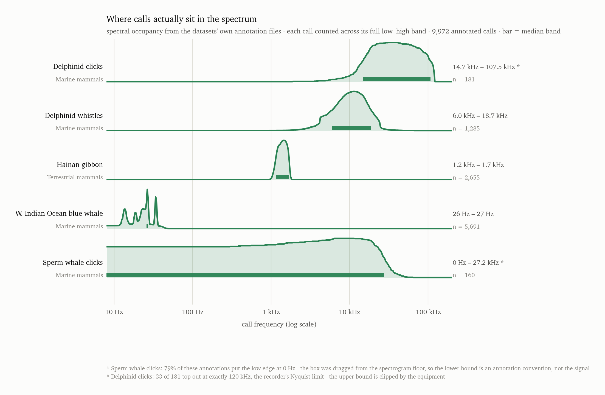
</picture>

| Call set | Clade | Median band | Calls |
|---|---|---|---|
| W. Indian Ocean blue whale | Baleen whales | 26 – 27 Hz | 5,691 |
| Hainan gibbon | Primates | 1.2 – 1.7 kHz | 2,655 |
| Delphinid whistles (CESCAB) | Toothed whales | 6.0 – 18.7 kHz | 1,285 |
| Delphinid clicks (CESCAB) | Toothed whales | 14.7 – 107.5 kHz | 181 |
| Sperm whale clicks (CESCAB) | Toothed whales | 0 Hz – 27.2 kHz * | 160 |

Each call is an interval rather than a point, so it is counted in every log-spaced bin its
band overlaps; the curves are spectral *occupancy*, normalised to each row's own peak.

**Mammal calls span four orders of magnitude — the widest range of any group in the
catalogue.** From a blue whale median band one hertz wide at 26 Hz to delphinid clicks
reaching beyond 100 kHz. Nothing in bird bioacoustics comes close to this spread; the birds
in the catalogue-wide figure all sit inside a single decade, 1–6 kHz.

**The split is within a single order, not between distant clades.** Cetacea alone covers the
entire range: baleen whales at the bottom, delphinid clicks at the top, with their own
whistles an order of magnitude below their own clicks. A pipeline built for one cetacean
signal type is not reusable for another from the same animal.

**The gibbon sits inside the bird band.** Its median 1.2–1.7 kHz falls squarely within the
1–6 kHz range where every bird dataset peaks, and its curve is a single sharp spike rather
than a hump. Frequency will not separate gibbon song from the birds calling over it — the
one terrestrial mammal here is the one whose calls look most like a bird's.

**Two rows are limited by their annotation, not by the animal**, and are marked `*` on the
figure. In the sperm whale set, 79% of boxes put the low edge at exactly 0 Hz — the selection
was dragged from the spectrogram floor, so that lower bound is a convention. In the delphinid
clicks, 33 of 181 top out at exactly 120 kHz, the recorder's Nyquist limit, so the upper
bound is clipped by equipment. Both rows are real data honestly plotted; neither should be
read as the animal's true band.

**Coverage is the main caveat.** These are five call sets from three source datasets, against
165 mammal datasets in the catalogue. Bats are absent entirely — not for lack of trying.
Bat Detective and the European bat reference set are access-restricted, the human-verified
bat library ships as one 2.1 GB archive, and ChirosetEurope's manifest carries sampling rate
but no per-call frequency. The Dryad elephant rumble corpus returns 401 on programmatic
download. So the clade with the most distinctive frequency signature in all of mammal
bioacoustics contributes nothing here, which is the access problem of section 9 showing up
as a scientific one.

### Call frequency by clade

The figure above is one row per call set. This one pools the same measurement into the twelve
mammal clades the rest of the report uses, so the rows line up with every other clade figure
and an empty row means something: no dataset in that clade publishes a frequency anyone can
read. `make_frequency_by_clade.py` builds it; the numbers are also in `frequency_by_clade.csv`.
**14,118 annotated calls, 8 sources, 4 of 12 clades.**

<picture>
  <source media="(prefers-color-scheme: dark)" srcset="figures/mammals/frequency-by-clade-dark.png">
  
</picture>

| Clade | Datasets | Sources | Calls | Median band | 10th–90th pct | Full range |
|---|---|---|---|---|---|---|
| Baleen whales | 31 | 2 | 8,698 | 18 – 32 Hz | 9.0 – 39 Hz | 0.2 Hz – 55 Hz |
| Toothed whales & dolphins | 27 | 3 | 2,200 | 6.0 – 20.5 kHz | 3.4 – 38.1 kHz | 264 Hz – 192.0 kHz |
| Primates | 27 | 2 | 3,060 | 1.1 – 1.7 kHz | 492 Hz – 1.7 kHz | 136 Hz – 2.1 kHz |
| Bats | 23 | — | — | **no per-call frequency published** | | |
| Carnivores (terrestrial) | 17 | — | — | **fixed band, not per-call** | | |
| Pinnipeds | 10 | 1 | 160 | 64 – 504 Hz * | 35 Hz – 1.4 kHz | 35 Hz – 3.1 kHz |
| Rodents | 10 | — | — | **fixed band, not per-call** | | |
| Ungulates & livestock | 7 | — | — | **no per-call frequency published** | | |
| Elephants | 5 | — | — | **no per-call frequency published** | | |
| Cetaceans (group not stated) | 3 | — | — | **no per-call frequency published** | | |
| Sirenians | 2 | — | — | **no per-call frequency published** | | |
| Other mammals | 2 | — | — | **no per-call frequency published** | | |

`*` The spotted seal corpus publishes measurements rather than drawn boxes, so its band is
the 5–95% energy bandwidth of each call — a per-call measurement, but not the same quantity
as a selection box.

**The four clades that do have data span more than four orders of magnitude**, from a baleen
whale median band of 18–32 Hz to delphinid clicks reaching 192 kHz. The gap between baleen
whales and toothed whales is the widest thing in the catalogue: two suborders of the same
order, with no overlap at all between their occupancy curves. Nothing about a blue whale
detector transfers to a dolphin click detector.

**Primates are narrow and sit inside the bird band.** Pooled median 1.1–1.7 kHz, and the
curve is a sharp spike rather than a hump — Hainan gibbon song is stereotyped. The ruffed
lemur adds a lower shoulder near 400 Hz, visible as the second faint line. Frequency will not
separate primate calls from the birds calling over them.

**Pinnipeds sit between the two cetacean modes**, 64–504 Hz, on a single corpus of 160 calls.
Treat that row as one dataset's answer, not the clade's.

**Eight of twelve clades have nothing, and the reason differs.** Six publish no per-call
frequency at all — including elephants, whose infrasonic rumbles are the one thing everyone
knows about them, and bats, which are 23 datasets and over half of all mammal audio files.
The other two, terrestrial carnivores and rodents, are worse in an interesting way: their
annotation files *do* have frequency columns, but every row carries the same band — 100–3,900
Hz for all 1,294 meerkat rows, 18–30 kHz for all 296 rat rows. That is the corpus's stated
range copied down the column, not a measurement, and plotting it would have drawn a rectangle
and called it a distribution. The same is true of the humpback whale corpus, which is why
baleen whales rest on two sources rather than three.

**The practical reading.** Per-call frequency is published for 8 source corpora out of 164
mammal datasets. Every clade-level frequency claim in this report rests on those eight, and
the four clades with rows are the four whose research communities happen to annotate in Raven
or Sonic Visualiser. This is an artefact of annotation tooling, not of the animals.

### Clades as a share of everything available

The clade chart above counts datasets. Here each clade's share of the data is drawn **on top
of its share of the datasets**, so the gap between the pale and dark bars is over- or
under-representation. Three measures, each a percentage of the mammal total on a shared
0–100 scale: audio files, recorded hours, and **annotated vocalizations** — a count of
labelled acoustic events, recovered by opening the datasets' own annotation files (see
*Counting the vocalizations* below).

<picture>
  <source media="(prefers-color-scheme: dark)" srcset="figures/mammals/clade-volume-dark.png">
  
</picture>

| Clade | % of datasets | % of files | % of hours | % of vocalizations |
|---|---|---|---|---|
| Baleen whales | 18.9% | 1.8% | **99.0%** | 16.2% |
| Toothed whales & dolphins | 16.5% | 0.9% | 0.3% | 3.4% |
| Primates | 16.5% | 34.7% | 0.3% | 33.9% |
| Bats | 14.0% | **51.4%** | <0.1% | **41.1%** |
| Carnivores (terrestrial) | 10.4% | 5.8% | 0.3% | 0.2% |
| Pinnipeds | 6.1% | 0.2% | <0.1% | 0.2% |
| Rodents | 6.1% | <0.1% | <0.1% | <0.1% |
| Ungulates & livestock | 4.3% | 0.5% | <0.1% | 0.4% |
| Elephants | 3.0% | <0.1% | <0.1% | 0.7% |
| Cetaceans (group not stated) | 1.8% | 4.7% | 0.1% | 3.9% |
| Sirenians | 1.2% | none reported | none reported | none reported |
| Other mammals | 1.2% | none reported | none reported | none reported |

**Read the gap between the two bars.** Dataset share is spread fairly evenly across the top
five clades, 10–19% each — the pale bars are all similar. The dark bars are not, and they
disagree with each other, because the three measures answer different questions.

**Hours measure recording effort.** Baleen whales are **99.0% of every recorded hour** from 13
datasets, five times their dataset share, because that clade is studied with year-round
bottom-mounted hydrophones that run whether or not a whale is calling.

**Files and vocalizations measure labelling effort**, and there the ordering inverts. Bats are
**51.4% of files and 41.1% of vocalizations**, primates 34.7% and 33.9%; together they hold
three quarters of every labelled event in the mammal subset, against dataset shares of 14.0%
and 16.5%. Those clades ship call libraries and clip corpora where one file is one call.
Baleen whales, dominant in hours, are 1.8% of files and 16.2% of vocalizations.

**The clearest case of the difference is bats against baleen whales.** Bats have 23 datasets
holding 1.25 million labelled calls and 23 recorded hours; baleen whales have 31 datasets
holding 492,000 labelled calls and 996,000 recorded hours. One clade publishes labels without
the continuous audio they came from; the other publishes continuous audio far faster than
anyone labels it.

Coverage differs by measure: 35 datasets have a file count, 39 a duration and 53 an annotation
count, 80 of 164 have at least one, and **84 have none of the three**. A "none reported" row is
not a zero; it is an unmeasured clade.

### The same clades, restricted to what you can actually download

Every figure above counts datasets whether or not anyone outside the originating group can
obtain them. This one applies the catalogue's own `publicly_available` field and keeps only
the datasets recorded as **yes**. That is deliberately strict: "partial" means some subsets
are open and the rest gated, and "unknown" means no survey checked, and neither is something
you can rely on downloading. Both are named on each row rather than folded into a single
closed bucket, because 42 of the 164 are unchecked rather than refused.

<picture>
  <source media="(prefers-color-scheme: dark)" srcset="figures/mammals/clade-public-dark.png">
  
</picture>

| Clade | All | Public | % | Partial | Unknown |
|---|---|---|---|---|---|
| Baleen whales | 31 | 18 | 58% | 6 | 5 |
| Toothed whales & dolphins | 27 | 13 | 48% | 2 | 4 |
| Primates | 27 | 11 | 41% | 1 | 11 |
| Bats | 23 | 14 | 61% | 3 | 5 |
| Carnivores (terrestrial) | 17 | 8 | 47% | — | 6 |
| Pinnipeds | 10 | 3 | 30% | 1 | 4 |
| Rodents | 10 | 8 | 80% | — | 1 |
| Ungulates & livestock | 7 | 5 | 71% | — | 2 |
| Elephants | 5 | 5 | **100%** | — | — |
| Cetaceans (group not stated) | 3 | 2 | 67% | 1 | — |
| Sirenians | 2 | 0 | **0%** | — | 2 |
| Other mammals | 2 | 0 | **0%** | — | 2 |
| **Total** | **164** | **87** | **53%** | **14** | **42** |

**Filtering barely changes which clades dominate.** Every clade's share of the subset moves by
at most three points — baleen whales 18.9% to 20.7%, primates 16.5% to 12.6%, rodents 6.1% to
9.2%. The ordering of the top five is unchanged. Whatever is driving access, it is not
strongly clade-specific, so the shape of this field is not an artefact of what happens to be
downloadable.

**The rate does vary, though, and the extremes are informative.** Elephants are 5 of 5 and
rodents 8 of 10, because both are small-corpus fields whose work is published as a Zenodo
deposit. Pinnipeds are 3 of 10 and primates 11 of 27, with 11 of the primate datasets simply
unchecked. **Sirenians and other mammals are 0 of 2 each** — the two clades that already had
no hours, no files and no frequency data also have no confirmed public dataset, so nothing in
this report about them rests on anything anyone can verify.

**What the filter costs you depends entirely on the measure, and that is the real finding.**

| Measure | Public | All | Retained |
|---|---|---|---|
| Datasets | 87 | 164 | 53% |
| Datasets with SED labels | 45 | 83 | 54% |
| Audio files | 2,224,748 | 2,538,946 | 88% |
| Recorded hours | 899,185 | 1,005,719 | 89% |
| Annotated vocalizations | 1,273,614 | 3,039,345 | **42%** |

Half the datasets disappear but **nearly 90% of the audio survives**, because the largest
archives — the ones that dominate every volume figure in this report — are mostly open. The
exception is annotated vocalizations, where **58% is lost**, and that is again one dataset:
the UK Bat Monitoring Programme's million call-passes are marked `partial`, and on their own
they are 57% of everything the filter removes. The next four are the DCLDE 2026 killer whale
corpus (225,000, unknown), the North Atlantic right whale upcall set (200,000, partial), the
Egyptian fruit bat corpus (91,080, not released) and InfantMarmosetsVox (73,000, unknown).

The practical reading is that **labels are gated more tightly than audio**. You can assemble
most of the recorded hours in this catalogue from public sources; you cannot assemble most of
the labelled calls.

### Which clades have detection labels

<picture>
  <source media="(prefers-color-scheme: dark)" srcset="figures/mammals/clade-sed-share-dark.png">
  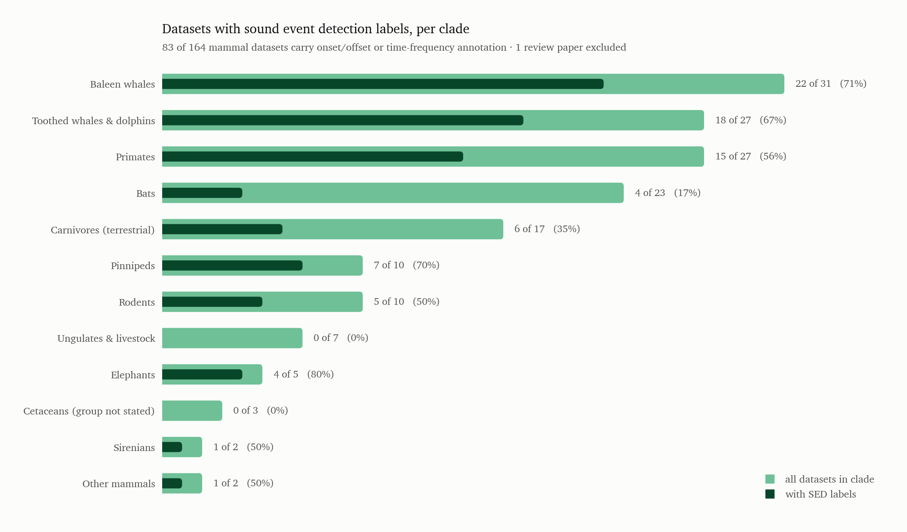
</picture>

**83 of 164 mammal datasets (51%) carry onset/offset or time-frequency annotation** (the one
review paper is excluded from every clade figure, since it has no annotation type). The dark
bar sits inside the pale one, so the fill ratio *is* the proportion, while the bar lengths
still carry how large each clade is.

**Bats are the striking row.** 23 datasets — the third-largest clade — and 51.8% of all
mammal audio files, but only **4 of 23** carry event-level labels. An enormous amount of bat
audio with almost no detection annotation on it. **Ungulates and livestock are 0 of 7**: every
one is a pre-segmented welfare corpus where the clip is the unit. The three "cetaceans, group not
stated" rows are 0 of 3, consistent with being poorly characterised rather than genuinely
label-free.

At the other end the passive-acoustic clades are densely annotated — elephants 4 of 5, baleen
whales 22 of 31, pinnipeds 7 of 10, toothed whales 18 of 27. When the recording is
continuous, an annotation has to say *when*, so event timing comes with the research design.
Note that fill ratio and bar length say different things: elephants have the highest rate but
only five datasets, while baleen whales supply 22 of the 83 SED-labelled datasets in the
whole mammal subset.

**The same question weighted by data.** A dataset count treats a 100,000-hour archive and a
90-clip corpus alike, so here is the same share measured by audio files, by recorded hours and
by annotated vocalizations. All three plot the *rate* rather than an overlay: clade volumes
span four orders of magnitude, and on one linear axis of absolute values every row but baleen
whales would collapse to a hairline.

<picture>
  <source media="(prefers-color-scheme: dark)" srcset="figures/mammals/clade-sed-share-files-dark.png">
  
</picture>

<picture>
  <source media="(prefers-color-scheme: dark)" srcset="figures/mammals/clade-sed-share-hours-dark.png">
  
</picture>

<picture>
  <source media="(prefers-color-scheme: dark)" srcset="figures/mammals/clade-sed-share-annotations-dark.png">
  
</picture>

**Overall, 51% of mammal datasets carry event-level labels; 29% of the vocalizations, 20% of
the hours and 15% of the files sit inside them.** The three disagree in an informative way.
Baleen whales are 71% of datasets and **91% of vocalizations** — nearly every labelled baleen
call has an onset and offset — yet only **19% of hours**, because three clip-level monitoring
archives hold 800,000 of the clade's 996,043 hours. Primates and bats run the other way: 15%
of their vocalizations are event-level, because MarmAudio's 871,044 clips and the large bat
reference libraries carry a label per clip and no timing.

Read the volume-weighted rows as indicative, not precise. Every row rests on the handful of
datasets that publish a count — at most 13 for hours, 11 for vocalizations, 7 for files — so
rodents (100%) is one dataset, and a 0% row such as baleen-whale files means only that
neither of the two datasets publishing a file count happens to be an SED dataset.

### Annotation type within each clade

The charts above ask how big each clade is. These ask what *kind* of data each clade holds:
every bar is normalised to that clade's own total, split by annotation type. The first figure
counts datasets, which exist for all 12 clades. Three more weight them by audio files,
recorded hours and annotated vocalizations — one figure each, all on the same row order.
Because only a minority of datasets publish each measure, every weighted panel is paired with
the composition of *exactly the datasets behind it*, so the two are read on one population
rather than two.

<picture>
  <source media="(prefers-color-scheme: dark)" srcset="figures/mammals/clade-annotation-datasets-dark.png">
  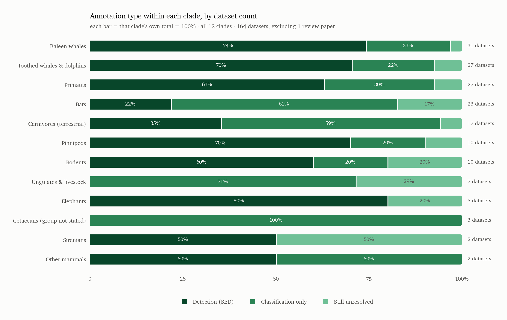
</picture>

**By dataset count the clades fall into two camps.** The passive-acoustic marine and primate
clades are detection-first — baleen whales 74%, toothed whales 70%, pinnipeds 70%, primates
63%, elephants 80%. The reference-library and welfare clades are classification-first — bats
61% classification against 22% detection, terrestrial carnivores 59% against 35%, ungulates
and livestock 71% classification and **no detection at all**. Cetaceans with no stated group
are 100% classification, which is really a symptom of being poorly characterised.

**By audio files.** 35 datasets publish one, covering 10 clades. Watch primates and bats,
where a single enormous clip corpus sets the whole bar.

<picture>
  <source media="(prefers-color-scheme: dark)" srcset="figures/mammals/clade-annotation-files-dark.png">
  
</picture>

**By recorded hours.** 39 datasets publish one, covering 10 clades. This is the measure most
distorted by concentration — three archives hold four fifths of the baleen-whale total.

<picture>
  <source media="(prefers-color-scheme: dark)" srcset="figures/mammals/clade-annotation-hours-dark.png">
  
</picture>

**By annotated vocalizations.** 53 datasets publish one, the best-covered of the three, and
the only measure that counts labelling effort rather than recording effort.

<picture>
  <source media="(prefers-color-scheme: dark)" srcset="figures/mammals/clade-annotation-annotations-dark.png">
  
</picture>

**Two different things were making the volume panels disagree with the dataset panel, and the
paired layout separates them.** The first is *sampling*: the dataset figure counts all 31
baleen datasets, the hours panel only the 13 that state a duration, so the two were never
describing the same group. The left-hand panels remove that — among the 13 baleen datasets
that do state a duration, 62% are detection, much closer to the 74% across all 31.

The second is *concentration*, and it is the real finding. Even on that matched population,
baleen whales fall from **62% detection by dataset to 19% by hour**, because three clip-level
monitoring archives — Ocean Networks Canada (500,000 h), MERIDIAN/MBARI (200,000 h) and NOAA
PIFSC (100,000 h) — hold 800,000 of the clade's 996,043 hours. Six archives account for 98% of
every mammal hour in the catalogue. Primates run the other way: 88% of their reporting datasets
are detection and 90% of their hours are, yet 99% of their *files* and 85% of their
*vocalizations* are classification, because MarmAudio's 871,045 short clips dominate both
counts on its own. A gap between a left panel and its right panel is therefore always the same
story — a few very large collections outweighing many small ones.

**Why the three figures disagree with each other.** They are built from overlapping but
different datasets. 35 mammal datasets have a file count, 39 a duration and 53 an annotation
count; 19 have both a file count and a duration, and only **18 have all three**. Opening the
datasets improved this a great deal — the files-and-hours overlap was 4 before — but the three
are still different samples of the same catalogue, not three views of one sample, and there is
no reason for them to agree exactly.

**Why most clades looked like they had no hours — and what was actually there.** Seven clades
published no duration in the catalogue: bats (23 datasets), pinnipeds (10), rodents (10),
ungulates and livestock (7), elephants (5), sirenians (2) and other mammals (2). Querying the
repository *descriptions* recovered almost nothing, so I opened the datasets themselves. Five
of the seven turned out to have durations that were simply never written down as a number:

| Dataset | Clade | Derived | How |
|---|---|---|---|
| African elephant animal-borne rumbles | Elephants | 62 h | stated "62 one-hour audio files" |
| ChirosetEurope | Bats | 22.9 h | 11,517 per-recording lengths in the manifest, summed; 1,595 files are 10x time-expanded so the conservative real-time figure is used |
| USCMed rat USVs | Rodents | 3.7 h | 27 WAVs read from the 5.9 GB archive's central directory, 250 kHz mono 16-bit |
| VOCAPRA goat | Ungulates | 2.3 h | 4,147 WAV sizes over the byte rate, 16 kHz mono |
| Right Whale Kaggle | Baleen whales | 16.7 h | stated "30,000 2-sec clips" |
| Soundwel pig | Ungulates | 0.6 h | 6,150 per-call `Dur` values summed (call time, not recording time) |
| CowRumIA | Ungulates | 0.5 h | 624 WAV sizes, 48 kHz mono |
| BootSnap mouse USV | Rodents | 0.25 h | 3 WAVs, 300 kHz mono |
| Spotted seal | Pinnipeds | 0.07 h | 160 per-call durations summed (call time) |

The method that worked most often was reading **WAV sizes out of a zip's central directory
over HTTP Range** — the byte rate comes from one file's header, so a 5.9 GB archive yields an
exact duration without downloading it. Full provenance is in `derived_volume.csv`, and these
values are kept out of the catalogue and applied as an overlay, so stated and derived never
blur: any clade carrying one is labelled "derived" on the figure.

**Hours now cover 10 of 12 clades, not 5.** Only sirenians and other mammals (hyrax, koala)
remain genuinely unrecoverable — four datasets between them, none with a resolvable access
URL. Note how small the recovered numbers are: bats went from "no data" to 23 hours, against
996,043 for baleen whales. The clip-corpus clades really are tiny in duration terms; what was
missing was the number, not the audio.

That still lines up with the annotation split. Duration is the natural unit for a
passive-acoustic deployment and an awkward one for a clip corpus, which is why the clades
that had to have their hours reconstructed are the same clades that are classification-heavy.

All four figures now carry a row for **every** clade in the same order, with an explicit
"no data" marker and the denominator (`0 of 23 datasets state one`) where a measure was never
published, so the panels line up row for row.

**Why these panels disagree with the dataset-count figure.** They are measuring different
things, over different subsets, and the gap is worth understanding before trusting either.

Take baleen whales. By dataset count the clade is 74% detection — 23 of its 31 datasets carry
event-level labels. By file count it is 100% classification. Both are correct:

| Baleen whales | Datasets | With a file count | Files | With a duration | Hours | With an annotation count | Vocalizations |
|---|---|---|---|---|---|---|---|
| Detection (SED) | 23 | **0** | — | 8 | 194,146 | 7 | 461,790 |
| Classification only | 7 | 2 | 45,000 | 4 | 800,017 | 1 | 30,000 |
| Still unresolved | 1 | 0 | — | 1 | 1,880 | 0 | — |

**Not one of the 23 detection datasets states a file count.** The files panel is therefore
built from two datasets — the Right Whale Kaggle set and Watkins — and both happen to be
classification corpora. "100% classification by files" means *of the 45,000 files anyone
counted, all sit in classification datasets*, not *this clade is classification*. The hours
panel behaves differently again: eight detection datasets do state durations, so detection
shows up at 19%, but three classification archives (Ocean Networks Canada, MERIDIAN/MBARI,
NOAA PIFSC) hold 800,000 hours between them and dominate the bar. Vocalizations tell a third
story: seven detection datasets publish a count against one classification dataset, so the
clade reads **94% detection** — the labelled baleen whale calls really are nearly all
event-level, which neither of the other two measures could show.

Each segment is now labelled with the number of datasets behind it, so a 100% slice built
from one or two datasets is visible as such.

**Read the volume panels with the denominators visible on every row.** Ten clades now have a
file count, ten a duration and ten an annotation count, but most rows still rest on one to
three datasets — "Carnivores 100% detection by hour" is three datasets, "Elephants 100%
detection by file" is one. The dataset-count figure above remains the only one that rests on
every dataset in every clade.

## 6. Labels, volume, coverage and overlap

### How much audio is there?

| | Datasets with a figure | of which measured | Total |
|---|---|---|---|
| Recorded hours | 39 of 164 | 15 | **1,005,719 h** |
| Recordings / files | 35 of 164 | 10 | **2,538,946** |
| Annotated vocalizations | 53 of 164 | 23 | **3,039,345** |

"Measured" means the number came from opening the dataset rather than from a description.
All three totals are dominated by a handful of entries. Three long-term archives — Ocean
Networks Canada (500,000 h), MERIDIAN/MBARI (200,000 h) and NOAA PIFSC (100,000 h) — are 79%
of all hours. One bat survey (>1 million call-passes) is 39% of all recordings and a third of
all vocalizations; MarmAudio alone is another 871,045 vocalizations. Treat these as
order-of-magnitude figures, not a census: **84 of the 164 datasets publish none of the three.**

### Counting the vocalizations

The catalogue records *whether* a dataset has labels, never *how many*. To get a count I went
to the annotation files themselves: 46 mammal datasets cite a Zenodo record, and a record's
file manifest is free to fetch, so each one could be triaged into annotation tables (small,
worth downloading) and audio archives (large, never downloaded). Two techniques did most of
the work:

- **HTTP Range requests against the ZIP central directory.** A ZIP's index lists every member
  and its uncompressed size, and it sits at the end of the file, so a few kilobytes of range
  requests enumerate a 66 GB archive. This gave exact file counts for archives nobody had
  counted, and let individual small members — an annotation CSV buried in a 1.9 GB zip — be
  extracted without downloading the rest.
- **Reading the WAV `fmt` chunk of one member, then applying its byte rate** to the summed
  member sizes. Rates in this subset run from 9.6 kHz to 250 kHz and channel counts and bit
  depths vary, so the header is read rather than assumed; where the first members disagreed,
  every member's header was read.

The result is `derived_annotations.csv`: **24 datasets, 951,832 counted events**, alongside
file counts and durations recovered on the same trip. Counting units differ and the file
records which applies to each row — a Raven selection, a Sonic Visualiser point, a DCASE POS
interval, or a labelled clip where one clip is one call.

| Dataset | Clade | Vocalizations | Unit | How |
|---|---|---|---|---|
| MarmAudio | Primates | **871,045** | labelled clip | `Annotations.tsv`; `Vocalizations.zip` holds exactly 871,045 FLACs, so one clip is one call |
| ATBFL (animal2vec) | Baleen whales | 15,633 | labelled segment | `labels.csv` inside the remote zip |
| ChirosetEurope | Bats | 11,517 | species-labelled recording | manifest, one row per recording |
| Hainan gibbon, social groups | Primates | 7,958 | song phrase | `phrase_annotations.csv` (its 32,706 "segments" are 4.8 s windows, not calls) |
| Crested gibbon PAM benchmark | Primates | 7,752 | labelled clip | three clip archives' central directories |
| Soundwel pig | Ungulates | 6,887 | labelled clip | spreadsheet; the audio archive holds exactly 6,887 WAVs |
| W. Indian Ocean blue whale | Baleen whales | 6,713 | Raven selection | two annotation tables |
| Gibbon song (Bornean/SE Asian) | Primates | 4,932 | Sonic Visualiser point | 96 tables |
| VOCAPRA goat | Ungulates | 4,147 | labelled clip | central directory |
| Dog-human social play | Carnivores | 2,962 | Raven selection | 30 tables; the recordings are mostly MP4 video |
| TemporalContext fin whale | Baleen whales | 2,765 | Raven note | five `.selections.txt` (254 further rows mark non-song and are excluded) |
| Hainan gibbon, 2019 release | Primates | 1,858 | call interval | train/test/extra labels; 670 non-gibbon rows excluded |
| Ruffed lemur | Primates | 1,780 | Sonic Visualiser point | 111 `.svl` files parsed as XML |
| CESCAB glider | Toothed whales | 1,626 | Raven selection | annotation table; the clip archive holds exactly 1,626 FLACs |
| MeerKAT | Carnivores | 1,294 | call interval | Voxaboxen MT component |
| Odontocetes, low-cost devices | Toothed whales | 694 | Raven selection | 29 tables, after de-duplicating the mixed-species tables that appear in two archives |
| Spotted hyena | Carnivores | 485 | POS interval | DCASE HT subset |
| CatMeows | Carnivores | 440 | labelled clip | 440 WAVs, one meow each |
| CowRumIA | Ungulates | 624 | labelled clip | central directory |
| USCMed rat | Rodents | 296 | annotated USV | 27 per-recording tables inside a 5.9 GB zip |
| Pilot whale (DCASE) | Toothed whales | 260 | POS interval | DCASE PB subset |
| Spotted seal | Pinnipeds | 161 | measured call | measurements CSV |
| DAS fin whale | Baleen whales | 3 | annotated track | one row per site; the dataset is HDF5 strain data, not audio |
| Gombe adult chimpanzees | Primates | — | not events | the spreadsheet catalogues 606 recordings, not calls |

For the other 29 datasets with a count, the figure is the catalogue's own prose ("~10,000+
annotated calls", ">225,000 call-level annotations"). Those are approximations and are used
only where nothing could be measured; where both exist, the measured number is used.

**Two things this turned up that the catalogue had wrong.**

*A stated duration that was 4.4x the release.* The catalogue gives the 2019 Hainan gibbon
release 6,000 h. Measuring all 18 of its audio archives — 3 labelled, 15 unlabelled, 9.6 kHz
stereo 16-bit — gives **186 WAVs and 1,374.8 h**, of which 251.3 h across 32 files carry
labels. The 6,000 h figure describes the wider monitoring programme, not the published data,
so the measured figure is used instead. It is the only row where a measurement overrides a
stated number.

*Widespread citation rot.* 46 mammal datasets cite 50 distinct Zenodo record IDs between them.
Fetching all 50 and reading the titles back:

| | Records | |
|---|---|---|
| Resolve to the dataset named | 28 | |
| Resolve to an unrelated work | 19 | the sperm whale DOI returns a Python package, the wolf howl DOI a neutrino-experiment talk, the meerkat *and* hyena DOIs the same mathematics preprint, the Pan-African primate DOI an Iraqi governance index, the elephant gunshot-detection DOI a Julia library |
| Restricted (HTTP 403) | 3 | correct record, files need an access request |
| Dead link (HTTP 404) | 2 | |
| Deleted by Zenodo as spam | 1 | the Antarctic blue whale record, removed in 2022 |

**18 of the 46 datasets have no working Zenodo citation at all.** A further one is subtler: the
yellow-bellied marmot dataset points at the Voxaboxen benchmark, which resolves and is a real
bioacoustics dataset, but none of its eight components is a marmot. A DOI that resolves is not
evidence that it resolves to the right thing, and this catalogue's provenance should be treated
as unverified wherever it has not been checked this way.

### What is labelled, and what is effectively unlabelled

<picture>
  <source media="(prefers-color-scheme: dark)" srcset="figures/mammals/label-depth-calltypes-dark.png">
  
</picture>

| Label depth | Datasets | Share of datasets | Hours behind them | Share of audio |
|---|---|---|---|---|
| Strong (event-level: onset/offset or boxes) | 83 | 50% | 203,944 h | 20% |
| Weak (clip-level labels only) | 44 | 27% | 802,000 h | 79% |
| Not characterised by any survey | 38 | 23% | 3,412 h | <1% |

Half the datasets carry a fifth of the audio; a quarter of the datasets carry four fifths of
it. Dataset counts and audio volume point in opposite directions here, which is why the
figure now labels both shares on the same bar.

**The unlabelled pool is the 44 weakly-labelled rows, not the 38 uncharacterised ones.**
Those 44 carry 802,000 hours, four times the entire strongly-labelled corpus, and they are
the long-term passive-acoustic archives: continuous ocean recordings with presence/absence or
species tags at clip level and nothing at event level. For anyone wanting large-scale
weakly-labelled mammal audio to pretrain on, that is where it is.

**The third bucket is a gap in the surveys, not a property of the datasets — read it that
way.** All 38 rows land there because `classification_labels` is `unknown`; **not one of
them has a survey positively recording that labels are absent.** Their names make clear that
most are ordinary clip-classification corpora whose labels simply went unrecorded — CatMeows,
DogSpeak, MarmAudio, BovineTalk, CowRumIA, VOCAPRA, the Soundwel pig repository, and the
SONOZOTZ / ChirosetEurope / EchoBank bat reference libraries. A bat reference library
obviously carries species labels; the survey just never filled the field. So this bucket
should be read as *"nobody wrote it down"*, and its 3,412 hours are a floor on what is
actually labelled, not a pool of unlabelled audio.

### Which datasets have call types

A call-type label is the layer above species: not "a marmoset called" but "a marmoset gave a
phee". `make_calltype_list.py` lists every dataset in the catalogue that has one —
`call_type_datasets.csv`, **126 of 288 resources** — and plots the mammal subset by clade.

<picture>
  <source media="(prefers-color-scheme: dark)" srcset="figures/mammals/calltypes-by-clade-dark.png">
  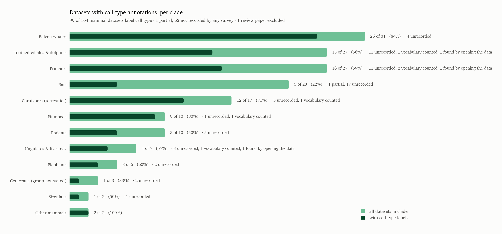
</picture>

| Clade | All | With call types | % | Not recorded by any survey |
|---|---|---|---|---|
| Baleen whales | 31 | 26 | 84% | 4 |
| Toothed whales & dolphins | 27 | 15 | 56% | 11 |
| Primates | 27 | 16 | 59% | 11 |
| Bats | 23 | 5 | **22%** | 17 |
| Carnivores (terrestrial) | 17 | 12 | 71% | 5 |
| Pinnipeds | 10 | 9 | **90%** | 1 |
| Rodents | 10 | 5 | 50% | 5 |
| Ungulates & livestock | 7 | 4 | 57% | 3 |
| Elephants | 5 | 3 | 60% | 2 |
| Cetaceans (group not stated) | 3 | 1 | 33% | 2 |
| Sirenians | 2 | 1 | 50% | 1 |
| Other mammals | 2 | 2 | 100% | — |
| **Total** | **164** | **99** | **60%** | **62** |

**Call-type labelling is the highest rate of any annotation beyond species**, and it tracks
whether a field studies repertoires. Pinnipeds are 9 of 10, baleen whales 26 of 31,
terrestrial carnivores 12 of 17 — all fields organised around named call classes.

**Bats collapse to 5 of 23.** Bat datasets are species-identification reference libraries:
the label is *which species*, not *which call*. That is the same clade that holds 51% of all
mammal audio files and, in the frequency section, the only ultrasonic measurement in the
catalogue. The largest body of mammal audio in this catalogue is also the one least often
labelled with what the animal was doing.

**Three datasets were added by opening the files rather than by reading the catalogue.**
CESCAB's signal types, the Hainan gibbon type codes and Soundwel's pig call classes are all
present in the annotation files while the catalogue records `unknown` — the same
survey-silence pattern found when probing annotation types. A vocabulary counted out of a
file is stronger evidence than a survey not looking, so they count as yes and are marked
`measured` in the list.

**Six vocabularies were counted in full**, which is worth seeing because "has call types" hides
a lot of variation in what that means:

| Dataset | Types | Vocabulary |
|---|---|---|
| Dog-human social play | 11 | single-letter codes, E (1,400), L (621), H (344), I (238), A (179) … |
| Spotted seal | 8 | Burp, Drum, Growl, Grunt, Knock, Moan, Pulse, Rumble — 20 calls each |
| MarmAudio | 7 | Vocalization (655,822), Twitter (65,309), Tsik (46,659), Phee (37,975), Trill (30,979), Infant (29,630), Seep (4,671) |
| Soundwel pig | 6 | LFs (2,513), LFt (1,267), Mixed (888), HFs (793), LFm (383), HFm (306) |
| Hainan gibbon | 4 | numeric codes 1–4, unnamed in the files |
| CESCAB | 2 | whistles (1,285), clicks (341) |

Three things stand out. **MarmAudio's largest class is "Vocalization"** — 75% of its 871,045
calls carry a label that means only *a call happened*, so the usable call-type subset is the
215,223 that have a real class. **The spotted seal set is exactly 20 calls per type**, a
designed repertoire sample rather than a corpus. And **two of the six publish codes without a
legend in the data** — the dog set's single letters and the gibbon's numbers — so the labels
are unusable without the paper.

**62 mammal datasets have no call-type value recorded by any survey.** As with the annotation
types, that is a gap in the surveys rather than a property of the datasets: three of the six
vocabularies above came out of exactly such rows.

### Taxonomic coverage per dataset

Species count is stated for 110 of 165 datasets.

| Species covered | Datasets |
|---|---|
| 1 (single species) | 85 |
| 2–9 | 12 |
| 10–99 | 11 |
| 100+ | 2 |

**77% of mammal datasets with a stated count cover exactly one species.** The multi-species
exceptions are almost all bat reference libraries — EchoBank (1,258 species), ChiroVox (230),
SONOZOTZ (69), ChirosetEurope (35) — plus Watkins (61 marine mammal species). So breadth and
call-type depth are inversely related: the datasets covering many species are the ones that
do not label call type, and vice versa.

### Frequency range per dataset, against volume

**This cross-tabulation cannot be computed from the catalogue, and the reason is worth
recording.** Only 11 of 165 mammal datasets state a sampling rate, and only 2 of those also
state their duration. Joining frequency band to hours leaves this:

| Frequency band | Datasets | Reporting hours | Hours | Recordings |
|---|---|---|---|---|
| Low-frequency (< 2 kHz ceiling) | 3 | 0 | — | 30,000 |
| Audible (2–25 kHz) | 4 | 1 | 1,068 | — |
| Ultrasonic (> 25 kHz) | 4 | 1 | 100,000 | — |
| Not stated | 154 | 23 | 908,288 | 2,592,106 |

154 datasets and 90% of the hours fall in "not stated". The 11 datasets with a known band are
listed in section 5's companion figure; individually they span 1 kHz (right whale) to 150 kHz
(mouse USV). Anything stronger would need the sampling rates read off the audio files
themselves.

**Why the unresolved slice nearly vanishes from the volume pies, and what that does *not*
mean.** Only 2 of those 17 datasets state a file count and only 1 states an hour count. A
dataset with an unstated size contributes zero to these pies, which is indistinguishable from
a dataset that is genuinely tiny — and the unresolved bucket is precisely the group least
likely to document its own size, because being poorly documented is why it is unresolved. So
read "0.1% of files" as *0.1% of the audio we can count*, not as evidence that these datasets
are small. The true volume behind Atlantic walrus, the Central African primate set,
BlueFinLibrary, EchoBank, the forest elephant PAM release and the rest is simply unknown.

### Probing the "not stated / unclear" datasets directly

The 31 datasets in that bucket were opened rather than read about. Where a repository exposed
a manifest or annotation file it was downloaded; where it only exposed a large archive, the
zip central directory was listed over HTTP Range so the contents could be seen without
fetching the audio. Full evidence per dataset is in `annotation_probe_results.csv`.

| Outcome | Datasets |
|---|---|
| Confirmed **clip-level classification** — labels exist, the surveys just never logged them | 14 |
| Confirmed **raw audio only** — genuinely no published annotations | 2 |
| Detection-style event tables, timing probable but unconfirmed | 2 |
| Not probeable (restricted, bulk-only archive, or dead link) | 4 |
| Not attempted — no resolvable access URL in the catalogue | 9 |

**Fourteen of the 31 are ordinary classification datasets whose labels were simply never
recorded by any survey.** The evidence is unambiguous in each case: MarmAudio ships an
`Annotations.tsv` with one row per clip carrying a call-type label; Soundwel's key
spreadsheet has call type, context, emotional valence and F0 per call; the spotted seal
release is a per-call measurement table with vocal type and centre/peak frequency; CatMeows,
CowRumIA, VOCAPRA and DogSpeak encode their classes in folder names or filenames (DogSpeak is
77,205 clips with breed, sex and individual ID in the path). None of these is unlabelled.
They were "unknown" only because the `classification_labels` field was left blank.

**Two are genuinely unlabelled at the repository.** The singing silver-haired bat release is
several hundred ~1 KB Anabat files named by timestamp with no annotation file beside them,
and BootSnap publishes three 180 MB WAVs and nothing else. If you want mammal audio with no
labels attached, those two are it — and they are small.

**Two look like detection data and deserve a closer look.** The forest elephant PAM release
ships `allEleObs_dep1_10.txt` (42 MB of elephant observations) alongside gunshot and diel
summaries, and the Mongolian gerbil release has a 988 MB `vocalization_df.csv` with one row
per vocalization. Both very likely carry event times, which would move them into the strong
bucket — but Dryad returns **HTTP 401 to programmatic download for every one of its seven
datasets here**, so neither could be confirmed. That is a systematic blocker, not a per-file
accident.

**The nine unattempted rows have no usable URL in the catalogue at all** — Atlantic walrus,
dugong, the Central African Primate set, PrimaVoice, BlueFinLibrary, DCLDE Oahu, the Yin &
McCowan dog bark corpus, the curated killer whale collection (arXiv link only) and the FAIR
bovine set (journal DOI only). Those are catalogue gaps, not dataset properties.

**These corrections are applied to the annotation-type pies above.** The 14 confirmed rows
move into *Classification only*, taking that bucket from 44 datasets to 58 and shrinking the
unresolved bucket from 31 to 17. `make_figures.py` reads `annotation_probe_results.csv` as an
overlay rather than editing the catalogue, so `bioacoustic_datasets_unified.csv` still records
what the surveys said and the correction stays auditable. One probed row is deliberately left
unresolved: the Mexican bat classifier release is a per-call feature table rather than an
audio corpus with labels, so calling it a classification *dataset* would overstate it.

#### What the 17 still-unresolved datasets actually are

Each of the 17 was chased a second time: Dryad's download endpoints retried three ways, the
paper DOIs followed to their data-availability statements, and every name without a URL
searched against Zenodo. The result splits sharply.

| Why it is unresolved | Datasets |
|---|---|
| No locatable record anywhere — catalogue holds no DOI, repo or URL, and Zenodo search finds nothing | 7 |
| Blocked by host access control (Dryad 401/403, Zenodo restricted) | 5 |
| Public but bulk-only — annotations not separable from a multi-GB archive | 1 |
| Dead reference — the identifier does not resolve | 2 |
| **Genuinely unannotated — confirmed by opening the release** | **2** |

**Only 2 of the 17 are unresolved because of the data.** The singing silver-haired bat
release is several hundred ~1 KB Anabat files with no annotation file beside them, and
BootSnap publishes three 180 MB WAVs and nothing else. Everything else is unresolved because
of plumbing.

**Seven have no locatable record at all** — Atlantic walrus, BlueFinLibrary, the Central
African Primate Vocalisation Dataset, DCLDE Oahu, dugong, PrimaVoice and the Yin & McCowan
dog bark corpus. The catalogue carries no DOI, repository or URL for any of them, and a
Zenodo search by name returns nothing resembling them. These are names harvested from prose
rather than datasets anyone located.

**Two references are simply dead.** The BovineTalk GitLab project 404s, and the arXiv id
given for the curated killer whale collection (`2602.09295`) returns zero entries — it does
not resolve to any paper.

**Five are gated, and one of those was newly located.** Following the Frontiers DOI for the
FAIR multi-farm bovine dataset leads to Zenodo `10.5281/zenodo.17764250`, which exists but is
restricted behind a Data Access Agreement for farm confidentiality, with no files listed.
EchoBank's European reference release is likewise Zenodo-restricted. The remaining three —
the forest elephant PAM release, the Mongolian gerbil corpus and the Mexican bat classifier
table — are all on Dryad, and **Dryad refuses programmatic download on every endpoint**
(`api/v2/files/<id>/download` → 401, `downloads/file_stream` → 403,
`stash/downloads/file_stream` → 403). A person with a browser could fetch all three in
minutes.

**That last point matters for the detection count.** The two datasets most likely to belong
in the detection bucket — forest elephant (`allEleObs_dep1_10.txt`, 42 MB of observations)
and the gerbil corpus (`vocalization_df.csv`, one row per vocalization) — are blocked purely
by Dryad's access control, not by anything about the data. If both carry event times, the
mammal detection count moves from 89 to 91 and the unresolved bucket drops to 15.

### Overlap with Earth Species Project's `alp-data`

[`earthspecies/alp-data`](https://github.com/earthspecies/alp-data) wraps 37 datasets behind
one Python interface. Matching its module list against this catalogue:

| | Count |
|---|---|
| alp-data datasets | 37 |
| Confidently present in this catalogue | 21 (19 distinct rows) |
| Probably present, name differs | 2 |
| **Not in this catalogue** | **14** |

The 21 confident matches collapse to 19 catalogue rows because `audioset`/`audioset_strong`
and `beans`/`beans_zero` each map to a single row here.

**Mammal datasets in both**, 6 confident plus 1 probable:

| alp-data module | Catalogue row | Clade |
|---|---|---|
| `watkins` | Watkins Marine Mammal Sound Database | Toothed whales / pinnipeds |
| `dclde2026` | DCLDE 2026 killer whale | Toothed whales |
| `macaques_coo_calls` | Macaque coo-call corpus | Primates |
| `infant_marmosets_vox` | InfantMarmosetsVox | Primates |
| `gibbon_solos` | Gibbon song datasets (Clink) | Primates |
| `giant_otters` | Giant otter vocal repertoire | Terrestrial carnivores |
| `dinardo_dolphin_whistles` | Dolphin whistle type classification corpus *(probable)* | Toothed whales |

So **alp-data covers about 4% of the mammal datasets in this catalogue** (7 of 165) — it is a
curated access layer, not a survey, and it is weighted toward birds.

#### How many of those carry sound event detection annotations?

Counting `geladas` (in alp-data, absent from this catalogue) there are eight mammal datasets
in alp-data. Reading what each wrapper actually exposes rather than what the source paper
describes:

| alp-data module | Event-level timing? | What a row gives you |
|---|---|---|
| `dclde2026` | **Yes — SED + frequency** | selection table with `Begin/End Time (s)` and `Low/High Freq (Hz)`, plus species, ecotype, call type, pod, clan |
| `gibbon_solos` | **Yes — SED** | Raven selection table with `Begin Time (s)`, clipped to audio duration |
| `infant_marmosets_vox` | **Yes — SED** | start and end time per vocalization; audio is sliced to that range |
| `watkins` | No | one pre-cut clip per row; species, `call_type`, `duration_s` |
| `macaques_coo_calls` | No | clip plus caller id, sex, weight |
| `giant_otters` | No | clip plus vocalization-type label |
| `dinardo_dolphin_whistles` | No | clip-level recordings of the whistle repertoire |
| `geladas` | No | clip-level call sequences |

**3 of the 8 carry sound event detection annotations, and only 1 of the 8 (`dclde2026`) also
carries frequency bounds.** The other five are classification corpora: the segmentation
happened upstream and the wrapper serves pre-cut clips, so there is nothing to detect.

That ratio matters if alp-data is your intended access path. It is a good route to mammal
*classification* data and a narrow one to mammal *detection* data — and for the frequency
work in section 5, `dclde2026` is the only mammal dataset it can supply. Note this describes
the wrapper, not the underlying release: several of these sources do have event timing in
their original files that alp-data does not surface.

**One mammal dataset alp-data has that this catalogue missed:** `geladas` — Gelada vocal
sequences (Gustison et al. 2016, *Theropithecus gelada*). No survey in the folder mentions
gelada or *Theropithecus*. Other alp-data entries absent here are mostly birds
(`bengalese_finch_calls`, `chiffchaff_id`, `littleowl_id`, `pipit_id`, `superb_starling`,
`corvid_wascher`, `arctic_bird_sounds`, `birdeep`), plus `insectset_459`, `animalspeak`,
`esp_raincoast`, `subsegmentation` and an annotated xeno-canto subset. Those are worth
importing if you want the catalogue to be a superset of alp-data.

## 7. Metadata

<picture>
  <source media="(prefers-color-scheme: dark)" srcset="figures/mammals/metadata-coverage-dark.png">
  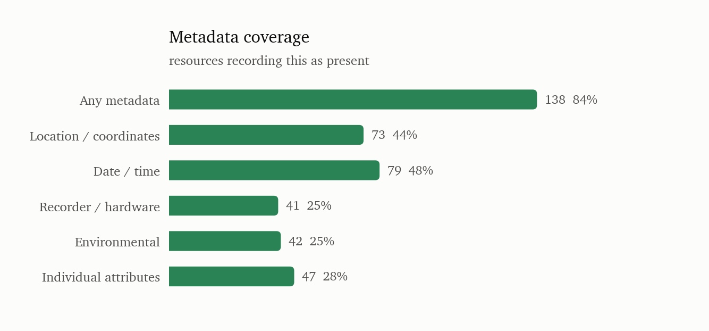
</picture>

## 8. Scale and vintage

<picture>
  <source media="(prefers-color-scheme: dark)" srcset="figures/mammals/scale-vintage-dark.png">
  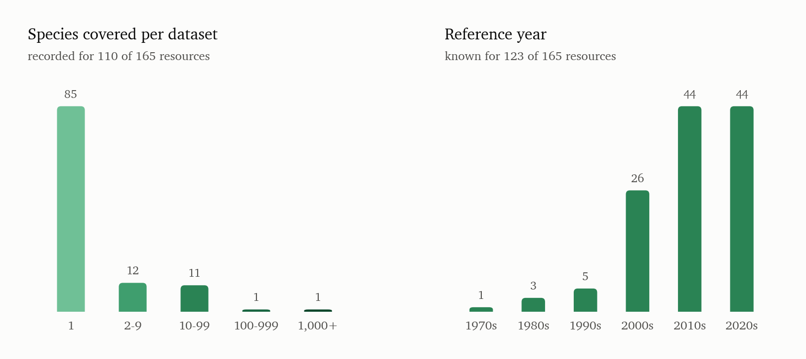
</picture>

Species count is recorded for 110 of 165; 85 of those (77%) are single-species. Reference
year is known for 123.

## 9. Release status

<picture>
  <source media="(prefers-color-scheme: dark)" srcset="figures/mammals/release-status-dark.png">
  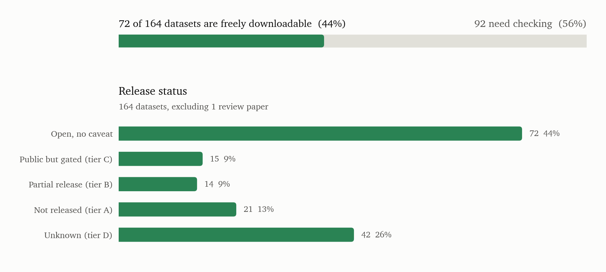
</picture>

| Status                    | datasets | share |
|---------------------------|----------|-------|
| Open, no caveat           | 72       | 44%   |
| Public but gated (tier C) | 15       | 9%    |
| Partial release (tier B)  | 14       | 9%    |
| Not released (tier A)     | 21       | 13%   |
| Unknown (tier D)          | 42       | 26%   |

**Mammal data is markedly harder to get than the catalogue average**: 44% freely
downloadable against 54% overall. 92 of 164 mammal datasets need checking before use.

### Not publicly released (21)

| UID       | Dataset                                                | Stated access route                                                    |
|-----------|--------------------------------------------------------|------------------------------------------------------------------------|
| BIOAC-095 | Beluga whale vocalisation dataset                      | Contact NOAA AFSC (Robyn Angliss, Manuel Castellote)                   |
| BIOAC-225 | Big Cat Acoustic Library (Panthera / Zoo datasets)     | Contact Panthera.org; some clips via Macaulay Library                  |
| BIOAC-235 | Common marmoset vocalisation datasets (lab colonies)   | Contact Princeton Neuroscience Institute (Asif Ghazanfar group) | Labo |
| BIOAC-115 | DECAF (Detecting Cetaceans by Acoustics in the Field)  | Contact NOAA SWFSC (Julie Oswald)                                      |
| BIOAC-117 | Dolphin Whistle Contour Dataset (DELPHINID)            | Contact NOAA SWFSC; some via PAMGuard                                  |
| BIOAC-022 | Egyptian fruit bat vocalization corpus                 | Original data described as public in Scientific Data; current Zenodo l |
| BIOAC-253 | Great ape vocalization sound-event detection corpora   | No unified public audio-and-annotation package verified                |
| BIOAC-126 | Hawaiian monk seal vocalisation data                   | Detector outputs/supporting info public; raw data available from autho |
| BIOAC-128 | Leopard seal acoustic dataset (Antarctic)              | Contact British Antarctic Survey                                       |
| BIOAC-132 | MBARI DORADO – Dolphin & Porpoise Clicks Dataset       | Contact MBARI (Monterey Bay Aquarium Research Institute)               |
| BIOAC-138 | MUPUS / DELPHI – Mediterranean Delphinid Survey        | Contact ACCOBAMS secretariat; some via PAMGuard library                |
| BIOAC-263 | Macaque coo-call corpus                                | Contact authors (Princeton/Max Planck) | Public/processed access via E |
| BIOAC-143 | NOAA/PMEL SOSUS / Hydrophone Array Long-term Data      | Contact NOAA PMEL (acoustic monitoring group)                          |
| BIOAC-139 | Narwhal Acoustic Dataset (Greenland / Canadian Arctic) | Contact DTU Aqua / Greenland Institute of Natural Resources            |
| BIOAC-153 | Pygmy/Dwarf Sperm Whale (Kogiidae) Click Dataset       | Contact Scripps / NOAA SWFSC                                           |
| BIOAC-155 | ROCCA odontocete call classification training data     | Integrated in PAMGuard software; contact NOAA/SWFSC | Training data re |
| BIOAC-275 | Snow leopard passive acoustic monitoring dataset       | Contact Snow Leopard Trust / Panthera                                  |
| BIOAC-282 | USCMed rat ultrasonic vocalizations                    | Public open version (an earlier Zenodo version is restricted)          |
| BIOAC-285 | Western lowland gorilla vocalisation data              | Contact Max Planck Institute for Evolutionary Anthropology             |
| BIOAC-163 | WhaleMoanDetector training corpus                      | Restricted/request access                                              |
| BIOAC-288 | Yin & McCowan dog bark corpus                          | Original audio was obtained by BEANS via personal communication; no op |

### Partial release (14)

| UID       | Dataset                                                    | Stated access route                                                    |
|-----------|------------------------------------------------------------|------------------------------------------------------------------------|
| BIOAC-096 | Blue whale vocalization dataset (multiple populations)     | Multiple sub-datasets; some via NCEI; DCLDE challenge data via CETUS   |
| BIOAC-116 | DFO Canada Pacific cetacean passive acoustic dataset       | Some data shared; primarily internal monitoring                        |
| BIOAC-019 | EchoBank (Global bat echolocation call library)            | —                                                                      |
| BIOAC-021 | Ecobat UK bat detector dataset                             | Data accessible via Ecobat platform; some public, some restricted      |
| BIOAC-122 | Fin whale 20Hz call dataset                                | Various sub-datasets; some via NCEI                                    |
| BIOAC-127 | Humpback whale song datasets                               | Multiple sub-datasets; some on Zenodo; some restricted | Some data via |
| BIOAC-135 | Minke whale Antarctic data (IWC/SORP)                      | Collaboration required                                                 |
| BIOAC-142 | NOAA PIFSC Pacific Islands cetacean passive acoustic data  | Some data on NCEI; full data via collaboration                         |
| BIOAC-144 | North Atlantic right whale upcall detection dataset (NOAA  | NOAA Fisheries / Kaggle 'Marine Mammal Detection' / NCEI | Some data v |
| BIOAC-148 | Orca Call Library (Center for Whale Research / OrcaLab)    | —                                                                      |
| BIOAC-150 | PAM Guard dataset contributions (multiple species)         | Tethys database contains PAM metadata; audio availability varies       |
| BIOAC-271 | Pan-African / Congo Basin primate acoustic datasets (PanAf | Contact Max Planck Institute for Evolutionary Anthropology (Catherine  |
| BIOAC-031 | UK Bat Monitoring Programme acoustic data                  | Processed acoustic data available on request; raw audio restricted     |
| BIOAC-162 | Whale FM (Zooniverse citizen science) – killer whale and p | Citizen science annotations; some data on Zooniverse                   |

## 10. Mammals against the whole catalogue

| Property                      | mammal (n=165) | non-mammal (n=123) | ratio |
|-------------------------------|----------------|--------------------|-------|
| Strong (onset/offset) labels  | 94 (57%)       | 80 (65%)           | 0.9x  |
| Time-frequency bounding boxes | 28 (17%)       | 22 (18%)           | 0.9x  |
| Call-type labels              | 96 (58%)       | 27 (22%)           | 2.7x  |
| Individual-identity labels    | 52 (32%)       | 5 (4%)             | 7.8x  |
| Behavioural-context labels    | 58 (35%)       | 7 (6%)             | 6.2x  |
| Location metadata             | 73 (44%)       | 67 (54%)           | 0.8x  |
| Licence unstated              | 123 (75%)      | 87 (71%)           | 1.1x  |
| Freely downloadable           | 72 (44%)       | 81 (69%)           | 0.6x  |

Mammal datasets are **richer in labels and poorer in access**, and the gap is not subtle.
Individual-identity labels are 8x more common than in non-mammal data, behavioural context
6x, call type 2.7x. That is the legacy of long-running focal-animal field studies and
captive colonies, where who called and in what context is the point — almost every dataset
with individual-level supervision in this catalogue is a mammal one.

Temporal precision is the opposite: strong onset/offset labels (57% against 65%) and
time-frequency boxes (17% against 18%) are slightly *less* common than in the rest of the
catalogue, where bird and soundscape benchmarks push the strong-label share up.

The same provenance explains the access gap. Mammal data tends to sit with a lab, an agency
or a long-term project rather than in a repository, which is why only 44% is cleanly
downloadable against 69% of non-mammal datasets.
