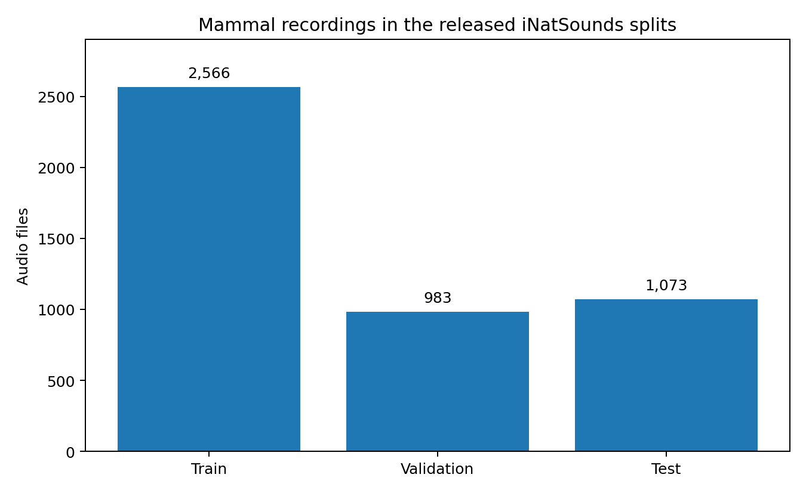
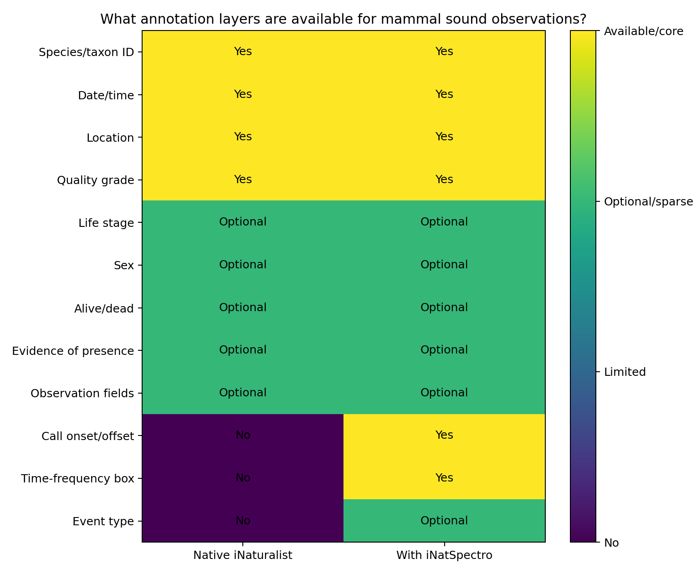
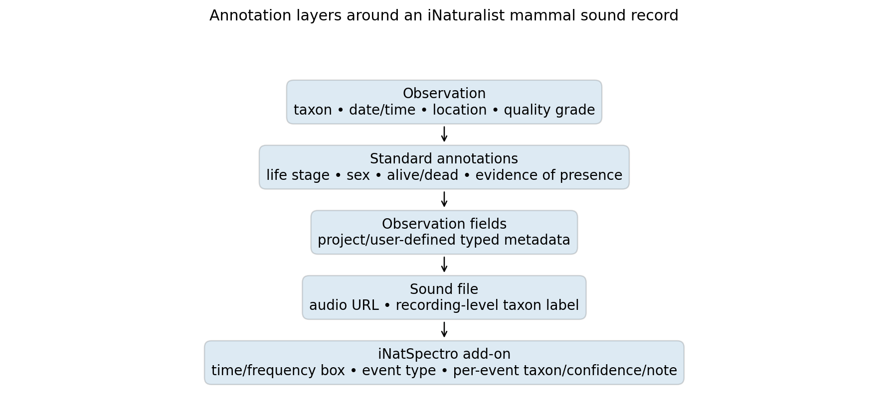

# iNaturalist mammal sounds: data volume, labels, and metadata

**Prepared:** 2026-09-28

## Executive summary

The best published quantitative snapshot I found for mammal audio on iNaturalist is **iNatSounds** (NeurIPS 2024), a curated release built from iNaturalist sound observations. Its mammal subset contains **296 mammal species in the training split** and **4,622 released mammal audio files across train/validation/test** (2,566 train; 983 validation; 1,073 test). Only **41 mammal species** meet the stricter criteria used for the validation/test species set.

These are **not the live totals on iNaturalist**. iNatSounds is a curated temporal snapshot with filtering and subsampling. The live iNaturalist corpus has continued growing.

Native iNaturalist sound observations are primarily **weakly labeled**: a sound is associated with an observation-level taxonomic identification plus observation metadata. Standardized biological annotations such as sex, life stage, alive/dead, and evidence of presence can be attached, but they are optional and coverage is heterogeneous.

Native iNaturalist does **not** provide a standard per-call sound-event annotation layer. However, **iNatSpectro**, a third-party browser extension introduced in 2026, can add human-drawn time–frequency boxes and event types to iNaturalist observations through a `Sound Annotation` observation field and an external training dataset.

## Mammal data volume

| Metric | Value |
|---|---:|
| Mammal species represented in iNatSounds training | **296** |
| Mammal species in evaluation set | **41** |
| Mammal training recordings | **2,566** |
| Mammal validation recordings | **983** |
| Mammal test recordings | **1,073** |
| Total released mammal recordings | **4,622** |

**Important:** the 296-species figure is the training-set species count. The 41 evaluation species are a subset satisfying the paper's cross-split observation criterion; they should not be added to 296 as additional species.

The full iNatSounds dataset contains about **230,000 audio files from >5,500 species** and >27,000 recordists. Across all taxa, mean duration is 19.52 s and median duration is 13.94 s; the paper does not report mammal-specific duration statistics.

## Annotation availability

Interpretation:

- **Available/core** = normal part of an iNaturalist observation or the add-on schema.
- **Optional/sparse** = supported, but not expected to be filled for every observation.
- The iNatSpectro column means *available when the third-party annotation layer is used*, not that every mammal recording has these labels.

### Native iNaturalist labels and metadata

**Taxonomic label.** Each observation has a community identification at some taxonomic rank. iNatSounds uses the observation to provide one species label per audio recording, making the released audio dataset a **recording-level / weak-label classification dataset**, not a native SED dataset.

**Spatiotemporal metadata.** Observation date, often observation time, geographic information, place, and associated provenance are available. Coordinates can be obscured by geoprivacy.

**Quality and provenance.** Quality grade (`research`, `needs_id`, `casual`), observer, identifiers, comments, projects, and tags can be available.

**Standard biological annotations relevant to mammals:**

| Annotation | Mammal-relevant controlled values |
|---|---|
| Life stage | Adult; Juvenile |
| Sex | Female; Male; Cannot Be Determined |
| Alive or dead | Alive; Dead; Cannot Be Determined |
| Evidence of presence | Organism; Bone; Construction; Hair; Scat; Track |

These fields are controlled by iNaturalist, but they are **optional**, so completeness will be much lower than taxonomic ID/date/location.

**Observation Fields.** User- or project-defined fields can hold typed text, numbers, dates, taxa, or controlled values. They can encode useful behavioral or sampling metadata, but they are not centrally standardized and can be redundant.

## Sound-event annotations: native vs. iNatSpectro

### Native iNaturalist

The core observation model does **not** impose:

- call onset / offset,
- temporal event segments,
- time–frequency bounding boxes,
- standardized call type,
- caller identity,
- overlap labels, or
- call-sequence boundaries.

So for a standard iNaturalist sound observation, the strongest generally available label is **“this recording is evidence for taxon X.”**

### iNatSpectro add-on

iNatSpectro adds a substantially stronger annotation layer. A human can draw a box on a spectrogram and optionally save it into the public iNaturalist **Sound Annotation** observation field.

The external iNatSpectro dataset schema contains:

- `time_start`, `time_end`
- `freq_low`, `freq_high`
- optional `annotation_type`
- optional per-event `taxon`
- optional confidence `conf`
- optional free-text `note`
- source `observation_id` and `sound_id`
- `quality_grade`
- `sample_rate`
- `time_expansion` (important for bat detectors)
- recording `duration`
- analysis `profile`

The indexed Hugging Face viewer reported **483 annotation rows across all taxa** in its current snapshot. Mammal records are present (for example *Pipistrellus pipistrellus*), but the viewer did not publish a mammal-only aggregate count in the indexed material, so I have **not** invented one.

## Implications for a mammal bioacoustics benchmark

For dataset design, I would separate iNaturalist into two resources:

1. **Large weak-label corpus:** use native iNaturalist / iNatSounds for taxonomic pretraining, retrieval, representation learning, and weakly supervised event localization.
2. **Small emerging strong-label corpus:** use iNatSpectro's time–frequency annotations as actual SED supervision, while treating it as a community-contributed add-on rather than comprehensive ground truth.

The key limitation is that even though iNaturalist has substantial mammal audio, the **published strongly localized mammal subset is currently tiny relative to the recording-level corpus**.

## Sources

- Chasmai, M., Shepard, A., Maji, S., & Van Horn, G. *The iNaturalist Sounds Dataset*. NeurIPS 2024.  
  https://papers.nips.cc/paper_files/paper/2024/file/ef3713b8d72266e803f9346088fed92d-Paper-Datasets_and_Benchmarks_Track.pdf
- iNatSounds project page: https://cvl-umass.github.io/iNatSounds/
- iNaturalist annotation definitions: https://help.inaturalist.org/en/support/solutions/articles/151000191830-what-are-the-definitions-of-inaturalist-annotations-
- iNaturalist tags / observation fields / annotations: https://help.inaturalist.org/en/support/solutions/articles/151000169941-what-are-tags-observation-fields-and-annotations-
- iNaturalist search URL documentation: https://help.inaturalist.org/en/support/solutions/articles/151000170738
- iNatSpectro annotation guide: https://www.inatspectro.org/usage/making-annotations.html
- iNatSpectro dataset: https://huggingface.co/datasets/japht/inatspectro-bioacoustics
